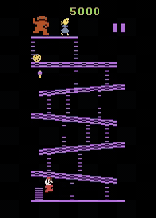

# Donkey Kong RL

A personal experiment in how far I can get a reinforcement learning agent to play
Atari Donkey Kong on one modest machine, and figuring out what actually makes a difference.

Donkey Kong (`ALE/DonkeyKong-v5`) is a hard game for RL. Rewards are sparse, episodes
run long, and it sits outside the usual Atari benchmark set, so there is not much to
compare against. I wanted to see how far I could push it, keep everything reproducible,
and leave an honest trail of what worked and what did not.



The trained policy under the stochastic evaluation protocol, looping both stages
(barrels and rivets) for a 44,800-point run. Shown at 6x speed; the girders recolor
each lap as the game ramps difficulty.

## Results

Plain PPO farms 100-point barrel jumps and never climbs (mean 4,027, zero screen clears).
Ten experiments later, self-imitation from a permanent demonstration buffer reaches a mean
of 22,820 with a best episode of 43,700, the 30k range, by a trained closed-loop policy.

The whole arc, each experiment a self-contained write-up with its config, numbers, and
figures, is in **[experiments/](experiments/README.md)**.

## Hardware

One modest machine: an aging NVIDIA GTX 1080 Ti (Pascal) and 12 CPU cores. The binding
constraint is not the GPU. Atari stepping is CPU-bound, so the 12 cores set the pace:
throughput tops out around 5,000 environment steps per second, with
[EnvPool](https://github.com/sail-sg/envpool) doing the vectorized stepping. The
Nature-CNN policy is small enough that the old GPU is never the bottleneck; it just runs
the learner updates. The practical consequences run through the whole project: training
is gated by CPU env-throughput, runs go one at a time, and the levers that mattered were
algorithmic, not more compute.

## Setup

Requires [uv](https://docs.astral.sh/uv/) and a CUDA-capable GPU with a driver
supporting CUDA 12.1.

```bash
git clone git@github.com:tctibbs/donkey-kong-rl.git
cd donkey-kong-rl
uv sync
```

Optional tracking with Weights and Biases: put `WANDB_API_KEY=...` in `.env`
(gitignored) or export it. Runs work without it (TensorBoard logs locally to `runs/`).

## Usage

Train (config-driven, every hyperparameter is a typed field):

```bash
uv run dkrl train --config configs/ppo_baseline.yaml
```

Evaluate a checkpoint under the standard ALE protocol (sticky actions p=0.25, full
action set, 108k-frame cap):

```bash
uv run dkrl evaluate --checkpoint checkpoints/<run_id>/final.pt --episodes 100
```

Measure the random-policy baseline:

```bash
uv run dkrl random-baseline --episodes 100
```

Every run writes a row to `results/ledger.jsonl` keyed by config hash, with git SHA,
seed, scores, frame count, and wall-clock, so results survive independently of any
tracking service.

## Reproducing results

Each ledger row records the exact config hash and git SHA. Check out that SHA, run the
config under `configs/` with the recorded seed, and scores should match within seed
noise. Headline results use 3 to 5 seeds and report mean, standard deviation, and
interquartile mean.

## Quality gates

```bash
uv run ruff check .
uv run ruff format --check .
uv run ty check
uv run pytest
```

CI runs the same gates on every push and pull request.

## Repository layout

- `src/dkrl/` package: config schemas, env construction, agents, training loops,
  evaluation, ledger, plotting
- `configs/` YAML experiment configs
- `results/` results ledger (committed; small text)
- `journal/` experiment journal, one lesson per file
- `docs/adr/` architecture decision records

## License

MIT. See [LICENSE](LICENSE).
