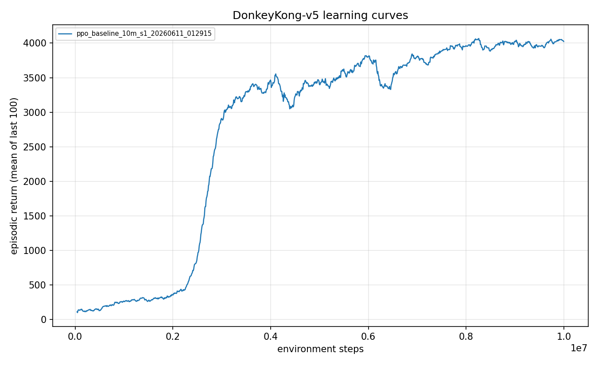
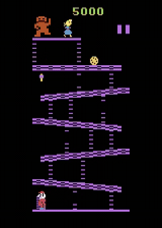

<!--
Experiment 01: the PPO baseline. Establishes the problem the rest of the suite chases.
Figures live in ./figures/ (learning_curve.png, gameplay.gif). No em dashes.
-->

# Experiment 01: The PPO baseline that never climbs

> A plain PPO agent trained for 10M steps scores about 4,027, which is 33 times the random baseline, yet it clears the first screen in 0 of 100 episodes because it has found a way to farm 100-point barrel jumps forever and never has to climb.

Donkey Kong is a climbing game: Mario starts at the bottom of a girder maze and the point is to reach the top. So I trained a textbook PPO agent for 10 million steps to see whether it would climb. It did not. It learned to stand at the bottom ramp and jump barrels for 100 points each until the bonus timer runs out and kills it, on every single episode. This experiment pins that failure down precisely.

## The question

This is the baseline, so the question is basic: drop a well-tuned PPO agent onto Donkey Kong with no help, and how far does it get? I expected it to get stuck farming the easy points, and I wanted that failure as a measured fact rather than a hunch, plus the two metrics the rest of the suite would be judged on (raw score and screen-1 clear rate).

The reward is the subject of this experiment, so it is worth restating. The Atari 2600 Donkey Kong port pays 100 per barrel jumped, 300 to 800 per hammer smash, and a per-screen completion bonus that starts at 5,000 and ticks down during play. The trap is in those numbers: barrel jumps are a reliable trickle of 100-point income available immediately at the bottom, while the 5,000-point payoff requires a long, zero-reward, death-risky climb. Reported scores are raw, unclipped game score.

## Method

There is no clever method here, and that is the point. This is plain [PPO](../../docs/glossary.md) with the CleanRL `ppo_atari_envpool` hyperparameters, the same defaults that learn Breakout and Pong without fuss. Nothing is added on top: no exploration bonus, no demonstrations, no curriculum. If this configuration could climb Donkey Kong on its own, the project would be over in one experiment. The interesting result is that it cannot, and watching where it gets stuck tells you what to add next.

I trained for 10M agent steps (40M frames), evaluated the final checkpoint over 100 episodes under the locked protocol, and separately measured the screen-1 clear rate. I also validated the harness on Breakout, swapping only the environment id, to confirm a flat Donkey Kong result was a fact about the game and not a pipeline bug.

## Configuration

```yaml
# key knobs (full file: ./config.yaml)
name: ppo_baseline_10m
algo: ppo
total_timesteps: 10_000_000   # 40M frames
seed: 1
env:
  env_id: DonkeyKong-v5
  num_envs: 64
  num_threads: 12
  full_action_space: true     # all 18 actions
  sticky_action_prob: 0.25    # Machado stochasticity at train time
  frame_stack: 4
  frame_skip: 4
ppo:
  learning_rate: 0.00025      # annealed to 0
  gamma: 0.99                 # discounts the distant climb bonus to near nothing
  gae_lambda: 0.95
  clip_coef: 0.1
  ent_coef: 0.01              # the only exploration pressure
  num_steps: 128
  num_minibatches: 4
  update_epochs: 4
```

## Results

Headline numbers from the 100-episode protocol evaluation (run `ppo_baseline_10m_s1_20260611_012915`).

| Metric | Value |
|---|---|
| Mean episode return | 4,027 +/- 458 |
| Median | 4,200 |
| Max | 4,500 |
| Min | 2,200 |
| Screen-1 clear rate | 0.00 (0 of 100) |
| Largest single-step reward, any episode | 100 |
| Random-play baseline | ~122 |
| Seeds | 1 |
| Training steps | 10M |

The agent averages 4,027, about 33 times the roughly 122 a random policy scores, so by raw score it looks like it learned a great deal. But the largest single reward it ever collects across all 100 episodes is 100 points. Not once does it trigger the screen-completion bonus, which would show up as a single jump of several thousand points (a measured clear pays about 4,200 in one step). The 4,027 average is not one good climb, it is roughly forty barrel jumps stacked up before the timer kills it. That is why the clear rate is exactly 0.00.

The learning curve climbs quickly to its plateau and then flatlines for the remaining millions of steps. It is not still improving when training ends; it has converged to the farming policy and sits there.



You can watch the local optimum directly. In every sampled frame Mario is at the bottom ramp, hopping barrels, never setting foot on a ladder:



Each life lasts about 1,100 agent steps, which lines up with the bonus timer running out rather than with any climbing attempt. The agent never dies trying to climb because it never tries to climb.

For sanity, the same pipeline on Breakout (3M steps, environment id swapped, sticky actions on) reached a best 100-episode return of 19.5 against a random-play score of about 1.2, with a curve shape consistent with CleanRL's published reference. So the flat Donkey Kong result is a fact about the game's reward landscape, not a broken harness.

## Discussion

A score of 4,027 tempts you to call it a win, but the clear-rate metric makes the failure unambiguous: the agent has not learned to play Donkey Kong, it has learned to exploit the one part that pays out without risk.

Why does PPO settle here? Climbing means abandoning a reliable 100-point income stream for a long chain of zero-reward actions that frequently ends in death, in exchange for a 5,000-point bonus the agent has never experienced. Discounting makes it worse: gamma 0.99 shrinks a reward hundreds of steps in the future to almost nothing, so even a partial ladder climb is barely rewarded. The barrel-farming policy is a genuine local optimum, and entropy-based exploration (ent_coef 0.01) is nowhere near enough pressure to escape it.

On limits: this is a single seed, so the exact 4,027 is preliminary, but the qualitative finding (a hard 0.00 clear rate, every reward capped at 100) is categorical enough that more seeds would not change the conclusion. One bookkeeping note: a separate score-only evaluation of the same checkpoint reported a mean of 4,084, the two differing slightly because of episode-level stochasticity under sticky actions. They agree on everything that matters: a few thousand points, no clears, ever.

The practical consequence is that raw score is a misleading headline for this game. A farming policy scores 4,000 while a clumsy but genuinely climbing policy might score less, and I would rather have the climber. From here on the primary progress metric is the screen-1 clear rate, with raw score reported alongside it, never instead of it.

## Takeaway

A textbook PPO agent on Donkey Kong does not climb. It finds a 100-point barrel-farming local optimum, scores 33 times random, and clears the first screen exactly zero times. The wall is not that the agent is weak, it is that the easy reward is right there at the bottom and the real reward is a long, risky climb away. Establishing that, and choosing clear rate over raw score, is what makes the rest of this project legible.

## Reproduce this

```bash
# Train the 10M-step PPO baseline (about 32 minutes at ~5,300 SPS on one GPU).
uv run dkrl train --config experiments/01-ppo-baseline/config.yaml

# Evaluate under the protocol (100 episodes, sticky 0.25, seed 1000), with clear-rate detection.
uv run dkrl evaluate --checkpoint checkpoints/<run_id>/final.pt --episodes 100 --clear-rate

# Figures.
uv run dkrl plot results/metrics/<run_id>.csv \
  --out experiments/01-ppo-baseline/figures/learning_curve.png
uv run dkrl video --checkpoint checkpoints/<run_id>/final.pt \
  --out gameplay.mp4 --episodes 4 --seed 7

# Harness sanity check on a game with published references.
uv run dkrl train --config experiments/01-ppo-baseline/config.yaml \
  --override env.env_id=Breakout-v5 total_timesteps=3_000_000
```

## References

- Proximal Policy Optimization, Schulman et al. 2017: https://arxiv.org/abs/1707.06347
- CleanRL `ppo_atari_envpool` (the baseline hyperparameters): https://docs.cleanrl.dev/rl-algorithms/ppo/
- Revisiting the ALE, Machado et al. 2018 (sticky actions, evaluation protocol): https://arxiv.org/abs/1709.06009