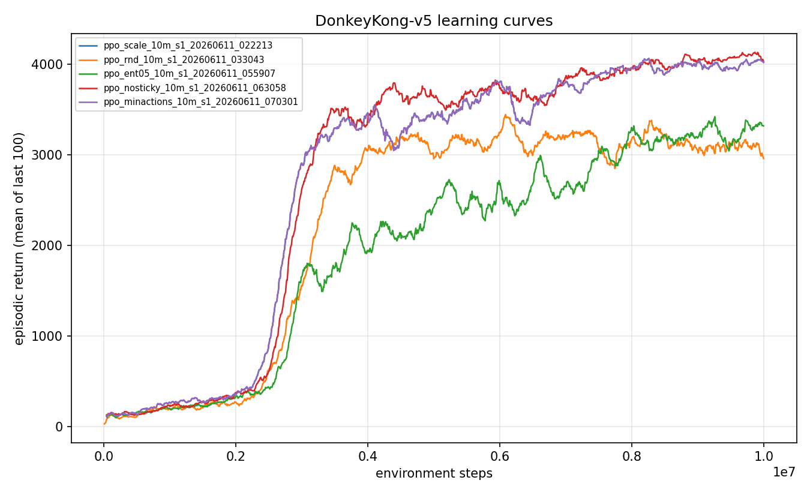

# Experiment 02: Why standard exploration fails on Donkey Kong

> One-line takeaway: when the barrier is a long, zero-reward, death-risky action chain, generic exploration (reward scaling, a longer horizon, RND, more entropy, no sticky actions, a smaller action set) buys you nothing. Every arm farms barrel jumps and clears zero screens.

In [experiment 01](../01-ppo-baseline/writeup.md) a plain [PPO](../../docs/glossary.md) agent learned fast and reliably to stand near the bottom ramp and jump barrels for 100 points each, settling around 4,027 with a screen-1 clear rate of exactly 0.00. It never climbed. The textbook next move: the agent is not exploring enough, so turn up exploration. Here I turned every standard exploration knob I had, one at a time, and watched all of them fail the same way.

## The question

The baseline found a safe local optimum (farming barrels) and never discovered the path to a screen clear. The standard diagnosis is "insufficient exploration," with well-known fixes: scale the reward so rare big payoffs are not drowned out, lengthen the discount horizon, add an intrinsic novelty bonus (RND), raise policy entropy, remove environment stochasticity, and shrink the action set.

My hypothesis was the conventional one: at least one of these should crack the discovery problem and produce the agent's first clear. The test is whether any standard exploration lever gets the agent to climb even once. Across six arms, the answer is no.

## Method

A sweep of single-variable changes, each layered on the [scale transform](../../docs/glossary.md) baseline so the arms are comparable. Two deltas matter here: the `ppo_minactions` arm reduces the full 18-action set to test whether a smaller search space helps, and under the farming policy the reward stream is literally just 0s and 100s (only the 100-point barrel jumps), because the bigger payoffs (an 800 hammer smash, a per-screen bonus) sit behind a long climb the agent never attempts.

Each arm is one PPO training run of 10M steps. The arms, by config name:

- **ppo_scale.** Reward scaling only (raw reward x 0.01 instead of clipping to +/-1), so rare big payoffs keep their magnitude instead of flattening to +1.
- **ppo_scale_g999.** Scaling plus a longer discount horizon, gamma 0.999 instead of 0.99.
- **ppo_rnd.** Scaling plus [Random Network Distillation](../../docs/glossary.md), an intrinsic bonus for visiting novel states. The textbook tool for hard-exploration games.
- **ppo_ent05.** Scaling plus a 5x higher entropy coefficient (0.05 instead of 0.01).
- **ppo_nosticky.** Scaling with [sticky actions](../../docs/glossary.md) off in training, in case the 0.25 action-repeat noise scrambled a useful sequence before it could form.
- **ppo_minactions.** Scaling plus a reduced action set.

The most informative result was one I did not expect. The ppo_scale arm turned out **bit-identical to the experiment-01 clipped baseline**: 1,220 of 1,220 metric rows matched exactly, and the final checkpoint hashed to the same value (1ecd8320ddaa5ebf). The reason is mechanical. Clipping maps any reward to +/-1; scaling multiplies by 0.01. A reward stream of only 0s and 100s maps to the same values under both (0 stays 0, gradient direction unchanged), so with identical seeding the two runs produced the same trajectory. The reward transform cannot matter until the agent first *experiences* a reward that clip and scale treat differently. It never does.

## Configuration

The full arm shown here is ppo_rnd (the others differ by the single knob named above).

```yaml
# key knobs (full file: ./config.yaml)
name: ppo_rnd_10m
seed: 1
total_timesteps: 10_000_000
algo: ppo_rnd          # RND intrinsic bonus on top of the scale transform
env:
  num_envs: 64
  num_threads: 12
  reward_transform: scale   # raw reward x 0.01, NOT clipped
  reward_scale: 0.01
```

The sibling arms swap one field: `algo: ppo` with `gamma: 0.999` (ppo_scale_g999), `ent_coef: 0.05` (ppo_ent05), `sticky_action_prob: 0.0` (ppo_nosticky), a reduced action set (ppo_minactions), or nothing added at all (ppo_scale).

## Results

Evaluation is 100 episodes under the full stochastic protocol (sticky actions p=0.25, 18 actions, no-op starts, raw scores, seed 1000). The defining number is the same in every row: clear rate 0.00.

| Arm (config) | Eval mean | Std | Median | Max | Clear rate | Run id |
|---|---|---|---|---|---|---|
| PPO clip baseline (exp 01) | 4,027 | 458 | 4,200 | 4,500 | 0.00 | ppo_baseline_10m_s1_20260611_012915 |
| ppo_scale | = baseline | | | | 0.00 | ppo_scale_10m_s1_20260611_022213 |
| ppo_scale_g999 | 4,041 | 476 | 4,200 | 4,500 | 0.00 | ppo_scale_g999_10m_s1_20260611_025635 |
| ppo_rnd | 3,275 | 895 | 3,650 | 4,200 | 0.00 | ppo_rnd_10m_s1_20260611_033043 |
| ppo_ent05 | 3,371 | 928 | 3,600 | 4,500 | 0.00 | ppo_ent05_10m_s1_20260611_055907 |
| ppo_nosticky | 3,881 | 654 | 4,200 | 4,400 | 0.00 | ppo_nosticky_10m_s1_20260611_063058 |
| ppo_minactions | 4,079 | 416 | 4,200 | 4,600 | 0.00 | ppo_minactions_10m_s1_20260611_070301 |

ppo_scale is reported as "= baseline" because it is bit-identical and shares the baseline's evaluation; see [the E1 journal note](../../journal/2026-06-10-e1-reward-scale-noop.md). A telling detail from the eval logs: in every arm the largest single-step reward across all 100 episodes was 100.0. Not one hammer (800), not one screen bonus (1,500+). The agents never touched anything but barrel jumps.

The training curves tell the same story. Every arm climbs to the farming plateau in the first 2 to 4M steps and then flattens. None pulls away upward, because there is no second reward regime to pull toward.



Two arms are worth a sentence each. RND, the tool designed for hard exploration, came in **worst** (mean 3,275, the highest variance, single-step max of 100 like the rest). Its intrinsic reward decayed to near zero by about 4M steps: the novelty it could reach without climbing was consumed (barrels and flames moving around the bottom of the screen), and it never spent that budget reaching the upper platforms, while the bonus dragged the score below plain PPO. Removing sticky actions (ppo_nosticky, mean 3,881) confirmed environment stochasticity was not the blocker either.

## Discussion

I was asking the wrong question. "Insufficient exploration" frames the problem as noise: the agent is not trying enough different things, so inject more randomness. The ppo_scale no-op exposes the real shape of the wall. Reward transforms, horizons, and entropy all assume the agent will eventually *stumble onto* the rewarding event and the change will help it weight that event correctly. Here it never stumbles onto it, because the rewarding event sits behind a long sequence of actions that pay nothing along the way and carry a high chance of death (a barrel, a flame, a missed ladder). Undirected exploration, however tuned, is exponentially unlikely to execute that whole chain by chance, and any single misstep resets it.

So these six negative results are the point, not a disappointment. Together they rule out an entire family of fixes and reframe the bottleneck: not exploration noise, but a discovery gap that only a *demonstration* of the path can cross. The arms even rank sensibly under that lens. The ones that added randomness without structure (RND, high entropy) hurt, because more random behavior near a cliff means more deaths; the ones that left behavior mostly intact (minimal actions, scaling) matched the baseline.

Limits worth stating plainly. Each arm is a single seed, so small differences between arms (3,275 vs 4,079) are not significant. The claim I stand behind is the categorical one, and it is robust: clear rate 0.00 across all six arms, and a maximum single-step reward of 100 in every evaluation. I also did not exhaust the exploration literature (no count-based bonuses, no episodic curiosity, no parameter-space noise); a more exotic method might help, but the consistency here made me stop tuning exploration and change strategy.

## Takeaway

When the barrier is a long, zero-reward, death-risky action chain, generic exploration does not help. Reward scaling was a literal no-op, a longer horizon stayed in the farming basin, and RND and extra entropy actively cost score. None of the six arms cleared a single screen. The problem is discovery of a specific behavior, not the amount of noise in the policy.

## What's next

If the agent cannot discover the climb on its own, the next move is to *show* it the climb. Experiment 03 drops the exploration framing and kickstarts the policy from demonstrations, holding the demonstrated behavior in place with an auxiliary loss while PPO improves execution.

Next: [Demonstration kickstarting breaks the first screen](../03-demonstration-kickstart/writeup.md).

## Reproduce this

```bash
# Train each arm (10M steps). Swap the config for the other arms.
uv run dkrl train --config experiments/02-why-exploration-fails/config.yaml   # ppo_rnd
uv run dkrl train --config configs/ppo_scale.yaml
uv run dkrl train --config configs/ppo_scale_g999.yaml
uv run dkrl train --config configs/ppo_ent05.yaml
uv run dkrl train --config configs/ppo_nosticky.yaml
uv run dkrl train --config configs/ppo_minactions.yaml

# Evaluate under the protocol (100 episodes, sticky 0.25, seed 1000).
uv run dkrl evaluate --checkpoint checkpoints/<run_id>/final.pt --episodes 100

# Overlay the failing arms' learning curves.
uv run dkrl plot \
  results/metrics/ppo_scale_10m_s1_20260611_022213.csv \
  results/metrics/ppo_rnd_10m_s1_20260611_033043.csv \
  results/metrics/ppo_ent05_10m_s1_20260611_055907.csv \
  results/metrics/ppo_nosticky_10m_s1_20260611_063058.csv \
  results/metrics/ppo_minactions_10m_s1_20260611_070301.csv \
  --out experiments/02-why-exploration-fails/figures/comparison.png
```

## References

- Random Network Distillation, Burda et al. 2018: https://arxiv.org/abs/1810.12894
- On bonus-based exploration not being a free win, Taiga et al. 2020: https://arxiv.org/abs/1908.02388
- Machado et al. 2018 evaluation protocol: https://arxiv.org/abs/1709.06009
- The reward-scaling no-op finding: [E1 journal](../../journal/2026-06-10-e1-reward-scale-noop.md)
- Previous experiment: [The PPO baseline that never climbs](../01-ppo-baseline/writeup.md)
- Next experiment: [Demonstration kickstarting breaks the first screen](../03-demonstration-kickstart/writeup.md)