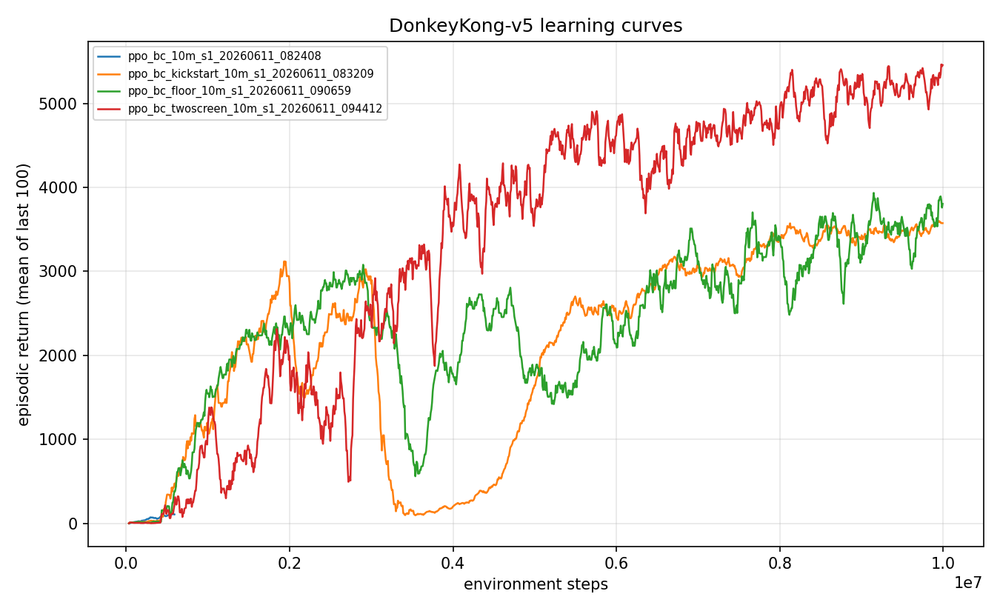
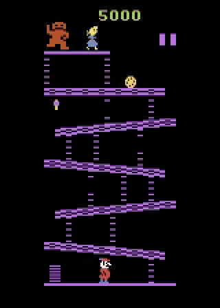

<!--
Experiment write-up: demonstration kickstarting. Every number traces to
results/ledger.jsonl. No em dashes.
-->

# Experiment 03: Demonstration kickstarting breaks the first screen

> Behavior cloning alone collapses, an annealed BC auxiliary loss buys the first clears but loses them when it fades, and a permanent BC floor plus two-screen demonstrations holds the climbing habit in place to reach mean 5,269 with a 0.93 clear rate.

[Experiment 02](../02-why-exploration-fails/writeup.md) ended in the farming basin: every exploration trick converged to an agent that jumps barrels at the bottom of the first screen for about 4,000 points and never climbs. A 4,200-point bonus sits at the top, but on-policy learning could not find a path to it. So I stopped asking the agent to discover the climb and started showing it, and the first screen finally fell.

## The question

Climbing is zero-reward until you reach the top, so the policy gradient cannot tell a good climb from a bad one. The obvious fix is demonstrations: record a scripted climber, clone its behavior, hand [PPO](../../docs/glossary.md) a policy that already knows how to climb. Does a demonstration prior survive contact with on-policy training, or does the dense farming reward wash it back out? And if it washes out, what is the cheapest thing that holds it in place?

## Method

I use the `scale` reward transform (raw reward times 0.01, not clipped), so a clear is worth about +42 to the learner versus +1 per barrel jump. The only shaping specific to this experiment is the behavior-cloning auxiliary loss below.

[Behavior cloning](../../docs/glossary.md) teaches a network to copy a demonstrator's actions by supervised learning. The problem: once you stop watching and start improvising under on-policy PPO, the moves you practice most are the ones that pay, and the move that pays is farming. The cloned climb fades.

Kickstarting keeps the teacher in the room. Instead of only initializing from the clone, I add a BC cross-entropy term directly to the PPO loss, so every gradient step is pulled partway back toward the demonstrated actions while PPO improves execution. The new idea over experiment 02 comes in three steps, each fixing the last one's failure:

1. **Annealed kickstart.** Start the BC auxiliary coefficient at 1.0 and anneal it linearly to 0 over 400 updates (about 3.3M steps). I expected PPO to experience enough full clears during the anneal to keep climbing once the pressure faded.
2. **A permanent floor.** Rather than anneal to zero, hold a small permanent coefficient (0.15) after the anneal. The teacher never fully leaves.
3. **Two-screen demonstrations.** Extend the scripted demonstrator past the first screen onto the rivets screen, so the demonstrated behavior is valuable on both screens, not just the climb.

To match training conditions, demos are collected under [sticky actions](../../docs/glossary.md) p=0.25, the same action noise PPO trains with. The first two arms use single-screen demos (`data/demos_screen1_sticky.npz`); the final arm uses two-screen demos (`data/demos_twoscreen_sticky.npz`, 25 episodes, mean return 5,728 under sticky 0.25).

## Configuration

This is the winning arm (`ppo_bc_twoscreen`); the other three flip `demo_path`, `aux_anneal_updates`, and `aux_coef_floor`.

```yaml
# key knobs (full file: ./config.yaml)
algo: ppo
total_timesteps: 10_000_000
env:
  num_envs: 64
  reward_transform: scale       # raw reward x 0.01, not clipped
  reward_scale: 0.01
bc:
  enabled: true
  demo_path: data/demos_twoscreen_sticky.npz   # two-screen demos, mean return 5,728
  epochs: 10                    # BC warm-start before PPO
  aux_coef: 1.0                 # initial BC auxiliary coefficient
  aux_anneal_updates: 400       # anneal 1.0 -> floor over ~3.3M steps
  aux_coef_floor: 0.15          # PERMANENT floor, never reaches zero
```

The four arms compared:

| Arm | Demos | Anneal | Floor |
|---|---|---|---|
| `ppo_bc` | single-screen | none (BC init only) | none |
| `ppo_bc_kickstart` | single-screen | 1.0 -> 0 over 400 | 0.00 |
| `ppo_bc_floor` | single-screen | 1.0 -> floor over 400 | 0.15 |
| `ppo_bc_twoscreen` | two-screen | 1.0 -> floor over 400 | 0.15 |

## Results

Evaluation is 100 episodes under the full stochastic protocol (sticky actions p=0.25, 18 actions, no-op starts, raw scores, seed 1000).

| Arm | Mean | Median | Max | Clear rate | Train clears | Seeds | Steps |
|---|---|---|---|---|---|---|---|
| `ppo_bc` (init only) | 4,075 +/- 555 | 4,200 | 4,600 | 0.00 | 0 | 1 | 10M |
| `ppo_bc_kickstart` (annealed) | 3,761 +/- 872 | 4,200 | 4,500 | 0.00 | 532 | 1 | 10M |
| `ppo_bc_floor` (single + floor) | 3,289 +/- 2,066 | 4,500 | 5,000 | 0.70 | 3,678 | 1 | 10M |
| `ppo_bc_twoscreen` (two + floor) | **5,269 +/- 1,483** | **5,500** | **6,800** | **0.93** | 7,840 | 1 | 10M |

The progression across the four arms is the whole story, so the comparison plot is the headline figure:



Read it left to right. **BC init alone** (`ppo_bc`) ends with zero training clears and an eval mean of 4,075, indistinguishable from the experiment-02 farming basin. The cloned climbing policy died to barrels under sticky actions before any clear paid out, and the dense farming gradient washed the prior away.

**The annealed kickstart** (`ppo_bc_kickstart`) was the first to clear anything. Its in-training clear rate rose from 0.06 at 0.5M steps to 0.25 during the anneal, 532 clears in total, the first nonzero clears in the project's history. Then it collapsed to 0.00 by update 400, exactly when the coefficient hit zero. Final eval mean 3,761, clear rate 0.00. The teacher left the room and the habit went with it.

**The permanent floor** (`ppo_bc_floor`, single-screen demos) is the fix that holds. Its training clear rate sat at 0.48 at 1.7M, was still 0.47 at the anneal boundary where the previous arm had already collapsed to 0.03, then rose on the floor alone to 0.81 by 10M. The floor does not merely preserve the prior; it keeps the behavior alive long enough for PPO to compound it. Eval clear rate 0.70, the first arm to pass the survives-screen-1 bar of at least 50 percent.

**Two-screen demos plus the same floor** (`ppo_bc_twoscreen`) is the production arm. Eval mean 5,269, median 5,500, max 6,800, clear rate 0.93. It beats the farming baseline outright on mean score, which the single-screen floor did not.

Watch the trained agent climb and clear the first screen:



### Why the annealed arm was right to give up

The collapse of the annealed kickstart is correct optimization, not a bug, and the arithmetic explains why the floor alone was not enough until the demos changed. Work it out in raw score per episode:

- **Farming the bottom ramp:** about 13 jumps at 100 each before the bonus timer kills Mario, roughly 1,300 per life, about 4,000 over three lives.
- **A successful clear:** about 4,200 bonus plus a few jumps, then the policy reaches the rivets screen it has never seen with single-screen demos, dies quickly, and respawns there scoring nothing. Episode total about 4,400.
- **A failed climb:** about 200.

At the annealed arm's peak execution reliability of 25 percent, an episode that attempts climbs is worth about 0.25 x 4,400 + 0.75 x 200 = 1,250, far below farming's 4,000. So the moment the auxiliary pressure faded, PPO abandoned climbing because at that skill level climbing was expected-value-negative. The credit assignment was working fine. The values were just wrong.

That diagnosis motivated the two-screen demos. If the policy is competent on both screens, a clear earns about 4,400 plus 400 to 1,300 of rivet points and eventually the second bonus, which dominates farming. The fix was never to push exploration harder. It was to raise the value of the demonstrated behavior so the floor had something worth defending.

## Discussion

It took three tries to learn one lesson: a demonstration prior is fragile, and on-policy reward erodes it unless something actively holds it in place. BC init alone lands on whatever the environment rewards, and here that is farming. The annealed kickstart proved PPO can experience full clears (532 of them) without learning to keep doing them, because keeping them was a bad bet at the skill it had reached. Only the permanent floor converts the rare clear into a stable habit, and only when the demonstrated behavior is valuable end to end does the agent beat the baseline it was trying to escape.

A few limits. These are single-seed runs, so the 5,269 headline needs replication (I ran two more two-screen seeds the same day, landing at clear rates 0.94 and 0.76, which already hints at seed variance worth quantifying). The agent clears screen 1 reliably but is still shallow: a 6,800 max means it is barely surviving into the rivets screen, not looping the game. The 7 percent of episodes that fail still pay almost nothing, the same bimodal failure mode (clears near 5,000 to 6,800, deaths near 0 to 300) the floor arm showed. And the "survives screen 1" and "maximizes score" goals genuinely conflicted at low skill, the kind of objective tension that only shows up once you are good enough to face the next screen.

## Takeaway

Behavior cloning alone collapses, an annealed BC auxiliary loss buys the first clears but loses them when it fades, and a permanent BC floor plus two-screen demonstrations holds the climbing habit in place to reach mean 5,269 with a 0.93 clear rate. The difference was not stronger imitation but keeping a small permanent pull toward demonstrated behavior, applied to demonstrations valuable enough to be worth defending.

## Reproduce this

```bash
# Train the production arm (two-screen demos + 0.15 BC floor).
uv run dkrl train --config experiments/03-demonstration-kickstart/config.yaml

# Reproduce the other three arms by pointing at their configs.
uv run dkrl train --config configs/ppo_bc.yaml            # BC init only
uv run dkrl train --config configs/ppo_bc_kickstart.yaml  # annealed, no floor
uv run dkrl train --config configs/ppo_bc_floor.yaml      # single-screen + floor

# Evaluate under the protocol (100 episodes, sticky 0.25, seed 1000).
uv run dkrl evaluate --checkpoint checkpoints/<run_id>/final.pt --episodes 100

# Figures.
uv run dkrl plot results/metrics/<run_id>.csv \
  --out experiments/03-demonstration-kickstart/figures/comparison.png
uv run dkrl video --checkpoint checkpoints/<run_id>/final.pt \
  --out gameplay.gif --episodes 1 --seed 1000
```

## References

- Kickstarting Deep Reinforcement Learning, Schmitt et al. 2018: https://arxiv.org/abs/1803.03835
- Previous experiment: [02 - why exploration fails](../02-why-exploration-fails/writeup.md)