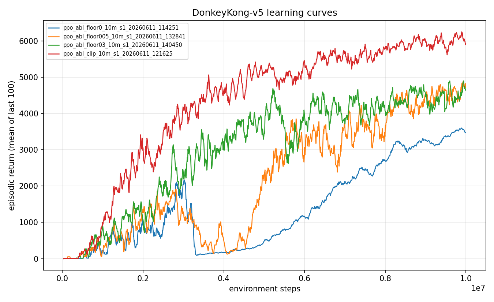

# Experiment 04: What actually mattered (ablations)

> One-line takeaway: of all the moving parts in the kickstarting recipe, the permanent BC pressure floor is the one load-bearing piece. Remove it and clears collapse to zero. The reward transform I had fought over for two experiments turns out not to matter at all once behavior is demonstrated.

In experiment 03 I got the agent to clear the first screen reliably by kickstarting PPO with two-screen demonstrations and a behavior-cloning auxiliary loss. But the recipe had a lot of knobs: which demos, a warm-start BC phase, an annealed auxiliary coefficient with a permanent floor, and a reward transform. "It works" is not "I know why it works." This experiment turns each knob one at a time, against the same reference recipe, to find which pieces carry the result and which are along for the ride.

## The question

I had a recipe that clears, but could not have told you which ingredient mattered. The repo treats "I can learn what mattered" as a first-class goal, equal to raw score, so a working recipe with no understanding is half the job. My suspicion: one or two components were doing all the work and the rest was superstition I had accreted while flailing. In particular, did the reward transform I spent [experiment 02](../02-why-exploration-fails/writeup.md) and a whole ADR arguing about still matter now that the agent was being shown good play, or had demonstrations made that argument moot? The clean way to find out is one-variable-at-a-time ablation: hold the reference recipe fixed, change exactly one thing, read the delta.

## Method

This experiment uses the standard MDP. The two shaping knobs under test are the [reward transform](../../docs/glossary.md), either clip (standard Atari sign-of-reward clipping) or scale (raw reward multiplied by 0.01, magnitudes preserved), and the auxiliary BC floor, the permanent minimum on the behavior-cloning loss term.

An ablation asks "what breaks if I remove this?" I fixed a reference recipe (call it R) and spun up arms that each differ from R by exactly one knob, so any change in result is attributable to that knob alone. R is the experiment 03 recipe: two-screen sticky demos, a 10-epoch BC warm-start, the auxiliary BC coefficient annealed from 1.0 over 400 updates down to a permanent 0.15 floor, the scale reward transform, 10M steps.

The arms, each one change off R:

- **Floor at 0.0, 0.05, 0.3** (`ppo_abl_floor0`, `ppo_abl_floor005`, `ppo_abl_floor03`): vary the permanent auxiliary floor. Floor 0.0 anneals the BC pressure all the way to nothing: the "do we even need a permanent floor" test.
- **Clip transform** (`ppo_abl_clip`): swap scale for the standard clipped reward. The knob I most wanted to settle.
- **Anneal over 100 updates** (`ppo_abl_anneal100`): hand off from BC to PPO four times faster than R.
- **No BC warm-start** (`ppo_abl_noinit`): skip the 10-epoch supervised pre-training, keep only the auxiliary loss during PPO.

Seed variance in this game is real, so I ran R and the clip arm across three seeds each. The single-variable arms are single-seed reads meant to localize the effect, not to publish a number.

## Configuration

```yaml
# key knobs (full file: ./config.yaml)
algo: ppo
total_timesteps: 10_000_000
env:
  num_envs: 64
  reward_transform: clip       # the knob under test; R used scale
bc:
  enabled: true
  demo_path: data/demos_twoscreen_sticky.npz
  epochs: 10                   # the BC warm-start; ppo_abl_noinit sets this to 0
  aux_coef: 1.0
  aux_anneal_updates: 400      # ppo_abl_anneal100 sets this to 100
  aux_coef_floor: 0.15         # the load-bearing knob; arms test 0.0 / 0.05 / 0.3
```

The committed `./config.yaml` in this folder is `ppo_abl_clip`, the clip arm. The other arms are the same file with the one field changed as noted in the comments.

## Results

All numbers are 100-episode evaluations under the full Machado protocol (sticky actions p=0.25, 18 actions, no-op starts, raw scores, seed 1000). R is the reference recipe; each other arm differs from R by one knob.

| Arm | One change vs R | Eval mean | Clear rate | Reading |
|---|---|---|---|---|
| R, seed 1 | reference | 5,269 | 0.93 | |
| R, seed 2 | seed only | 5,227 | 0.94 | headline robust |
| R, seed 3 | seed only | 4,248 | 0.76 | seed variance is real |
| clip, seed 1 | clip instead of scale | 6,035 | 0.98 | best single checkpoint |
| clip, seed 2 | seed only | 4,503 | 0.75 | |
| clip, seed 3 | seed only | 4,983 | 0.84 | clip vs scale is a wash |
| floor 0.0 | no permanent pressure | 3,422 | 0.00 | total collapse |
| floor 0.05 | weaker floor | 4,591 | 0.81 | partial hold |
| floor 0.3 | stronger floor | 4,392 | 0.78 | over-constrains |
| anneal 100 | shorter BC handoff | 4,686 | 0.82 | longer handoff helps |
| no BC init | auxiliary loss only | 4,735 | 0.83 | warm-start is optional |



Three things fall out of this table.

**The floor is load-bearing.** Floor 0.0 is the only arm whose clear rate collapses to 0.00. Removing the permanent pressure does not merely weaken the recipe, it reverts the agent all the way back to farming 100-point barrel jumps at the bottom of the screen, scoring 3,422 and never clearing. The floor sweep 0.0 / 0.05 / 0.15 / 0.3 yields clear rates 0.00 / 0.81 / 0.93 / 0.78, an inverted U that peaks near 0.15: enough pressure to hold the demonstrated behavior in place, not so much that imitation fights optimization.

**The reward transform is a wash.** The result I cared about most. Across three seeds each, clip {6,035, 4,503, 4,983} and scale {5,269, 5,227, 4,248} are statistically indistinguishable. The mean of means is 5,174 for clip and 4,915 for scale, well inside the seed-to-seed spread R alone shows (4,248 to 5,269). The transform I had argued was decisive simply does not matter once the agent has been shown the behavior.

**Warm-start and long anneal help, but are not required.** The no-BC-init arm (4,735 / 0.83) and the short-anneal arm (4,686 / 0.82) both land within roughly 10 to 15 percent of R. They smooth the result, they do not hold it up. The auxiliary loss during PPO carries the behavior; the supervised warm-start before PPO is a nicety.

## Discussion

I had been crediting the wrong component. For two experiments I treated the reward transform as the central design choice, with an ADR and a mechanism story for why farming is optimal under clipping. The mechanism was not wrong about why a clipping agent farms; it was wrong about whether that mattered to the final recipe. The transform is both unreachable before demonstrations (a from-scratch agent never gets deep enough for the magnitude difference to bite) and irrelevant after them (this three-seed wash). Demonstrations plus the floor carry everything; the transform rides along.

The floor result has real teeth and is slightly counterintuitive. The two-screen demos have a realized value that beats farming, so you might expect that once the agent has imitated them the PPO gradients would happily keep clearing on their own. They do not. When the auxiliary pressure anneals to zero (floor 0.0), the agent reverts to farming with a 0.00 clear rate. At the moment the anneal ends, the policy's execution is not yet good enough for clearing's expected value to win, so the live gradients still point back at farming. The permanent floor bridges that execution gap and holds the behavior in place long enough for execution to catch up. This matches the in-training clear rate I saw elsewhere: it kept rising after the anneal finished (0.47 to 0.81), which only happens if something keeps the behavior pinned while PPO sharpens it.

Limits. The single-variable arms (floor 0.0/0.05/0.3, anneal 100, no init) are single-seed reads. Given that R alone swings from 4,248 to 5,269 across seeds, I would not stake a precise number on any one of them. What I trust is the qualitative localization: floor 0.0 collapsing to exactly 0.00 clear rate is not seed noise, it is a different regime, and clip-vs-scale is multi-seeded because that was the claim I needed to be sure about. I did not test interactions (does the floor still matter without the warm-start, etc.); these are strictly one-at-a-time deltas off R.

## Takeaway

Exactly one piece of the kickstarting recipe is load-bearing: the permanent behavior-cloning floor. Set it to zero and the agent forgets how to clear and goes back to farming (clear rate 0.00); set it near 0.15 and the behavior holds. The reward transform I argued about for two experiments is, once behavior is demonstrated, within seed noise (clip 5,174 vs scale 4,915 mean of means). Warm-start and long anneal help a little and are otherwise optional. Knowing which knob matters is worth as much here as the score it produces.

## What's next

The floor is the one piece I cannot drop, and clip is as good as scale (and simpler and more standard), so I can lock the recipe and stop tuning. Does it hold up when scaled? The next experiment runs this exact recipe as the production agent at 25M steps over multiple seeds, built on `ppo_abl_clip`: [The 25M final agent](../05-final-agent-25m/writeup.md).

## Reproduce this

```bash
# Reference recipe R (scale transform), and the clip arm. Run each over seeds 1-3.
uv run dkrl train --config configs/ppo_abl_clip.yaml --seed 1
uv run dkrl train --config configs/ppo_abl_clip.yaml --seed 2
uv run dkrl train --config configs/ppo_abl_clip.yaml --seed 3

# Single-variable arms (each is ppo_abl_clip with one field changed).
uv run dkrl train --config configs/ppo_abl_floor0.yaml      # aux_coef_floor: 0.0
uv run dkrl train --config configs/ppo_abl_floor005.yaml    # aux_coef_floor: 0.05
uv run dkrl train --config configs/ppo_abl_floor03.yaml     # aux_coef_floor: 0.3
uv run dkrl train --config configs/ppo_abl_anneal100.yaml   # aux_anneal_updates: 100
uv run dkrl train --config configs/ppo_abl_noinit.yaml      # bc.epochs: 0

# Evaluate each under the protocol (100 episodes, sticky 0.25, seed 1000).
uv run dkrl evaluate --checkpoint checkpoints/<run_id>/final.pt --episodes 100

# Comparison figure across arms.
uv run dkrl plot-compare --runs <run_id_1> <run_id_2> ... \
  --out experiments/04-what-mattered/figures/comparison.png
```

## References

- Kickstarting RL agents, Schmitt et al. 2018: https://arxiv.org/abs/1803.03835
- The Arcade Learning Environment evaluation protocol, Machado et al. 2018: https://arxiv.org/abs/1709.06009
- Previous experiment: [03 - kickstarting PPO with demonstrations](../03-demonstration-kickstart/writeup.md)
- Next experiment: [05 - the final agent at 25M steps](../05-final-agent-25m/writeup.md)
