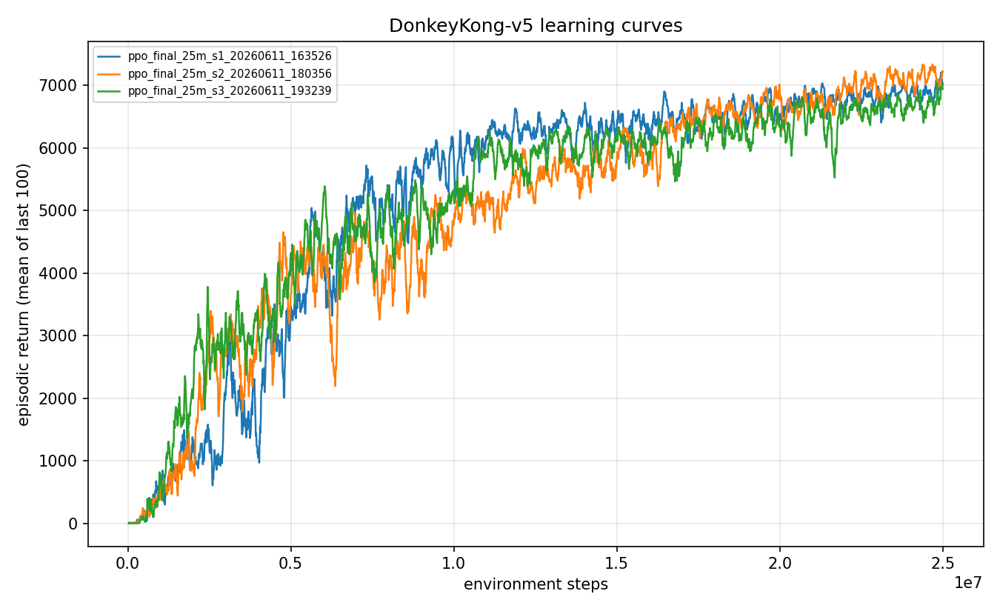
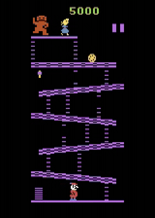

# Experiment 05: The 25M final agent

> The production recipe (clip transform, two-screen sticky demos, BC init, auxiliary BC annealed to a 0.15 floor), trained to 25M steps across three seeds, pools to a mean of 6,884 with a 0.973 clear rate. It essentially solves the barrels screen and plays the rivets screen consistently.

After three phases of figuring out what actually moved the needle, I stopped tuning and committed. I took the single recipe that survived every ablation, scaled it to 25M steps, and ran three seeds so the headline number would carry a real confidence interval rather than a single lucky curve. This is the closed-loop policy the rest of the project is measured against.

## The question

By the end of [experiment 04](../04-what-mattered/writeup.md) I knew which knobs were load-bearing: a clipped reward transform, demonstrations spanning both screens under sticky actions, a behavior-cloning warm start, and an auxiliary BC term that anneals from 1.0 down to a permanent 0.15 floor rather than vanishing. That recipe was reliable but I had only run it to 10M steps, where it averaged around 5,174 with a visibly bimodal evaluation distribution: roughly half the episodes cleared the first screen cleanly, the other half died at the climb into the rivets screen.

Does the horizon matter? If the failed-climb mode was just undertraining, more steps should collapse the bimodal distribution into a single reliable mode. If 10M was already converged, more compute buys nothing. I wanted a production-grade answer (three seeds, an interquartile mean, a bootstrap confidence interval) so this number could anchor every later comparison.

## Method

The recipe is frozen; only the budget changes. [PPO](../../docs/glossary.md) is the base learner. Before training, the policy is warm-started by behavior cloning on a demonstration set covering both screens under sticky actions, so the agent begins knowing the rough shape of a clear. During PPO, an auxiliary behavior-cloning term holds that demonstrated behavior in place while PPO improves execution. It starts at coefficient 1.0 and anneals over 400 updates to a permanent floor of 0.15, so the cloned behavior is never fully released and cannot wash out the way earlier pure-BC attempts did.

The only change versus experiment 04 is scale: 25M steps instead of 10M, three seeds instead of one. The bet is that the failed-climb mode at 10M is a training-time artifact, and that more than twice the budget consolidates the policy onto the clear-and-continue mode.

## Configuration

```yaml
# key knobs (full file: ./config.yaml)
name: ppo_final_25m
algo: ppo
total_timesteps: 25_000_000     # the lever this experiment pulls (was 10M)
env:
  num_envs: 64
  num_threads: 12
  reward_transform: clip        # the winning transform from phase 3
bc:
  enabled: true
  demo_path: data/demos_twoscreen_sticky.npz   # demos spanning both screens
  epochs: 10                    # BC warm start before PPO
  aux_coef: 1.0                 # auxiliary BC term, annealed...
  aux_anneal_updates: 400
  aux_coef_floor: 0.15          # ...down to a permanent floor (never zero)
checkpoint_interval_updates: 400
# run at seed: 1, 2, 3 for the headline
```

Each run trained at about 4,700 steps per second, roughly 88 minutes of wall-clock on the box's single GTX 1080 Ti. Config hash `3b17b4abc327`, training git SHA `3011b9735976`.

## Results

Evaluation follows the full stochastic protocol: 100 episodes per seed, sticky actions p=0.25, full 18 actions, up to 30 no-op starts, no episodic-life trick, raw scores, protocol seed 1000. The headline pools all 300 episodes across the three seeds, with a 10k-resample percentile bootstrap for the intervals.

| Metric | Value |
|---|---|
| Mean episode return (pooled, 300 eps) | 6,884 (95% CI 6,724 to 7,027) |
| IQM | 7,071 (95% CI 6,951 to 7,191) |
| Median | 7,100 |
| Std | 1,327 |
| Max | 8,300 |
| Screen-1 clear rate | 0.973 |
| Seeds | 3 (s1, s2, s3) |
| Training steps | 25M per seed |

The three seeds landed close together: seed 1 scored mean 6,991 at 1.00 clear (it cleared all 100 evaluation episodes), seed 2 mean 6,958 at 0.95 clear, seed 3 mean 6,702 at 0.97 clear. Maxima were 8,100, 8,300, and 8,200. The agreement across seeds is the reassuring part: this is a recipe, not a single lucky curve.

The three training curves overlay tightly and climb steadily rather than spiking and collapsing, which is exactly what the annealed-to-a-floor auxiliary term is meant to produce.



And the policy in motion, clearing the barrels screen and then working the rivets screen:



The horizon question got a clear yes. At 10M the same recipe averaged about 5,174 with a bimodal distribution; at 25M the failed-climb mode is nearly gone, the pooled mean rose to 6,884, and the standard deviation roughly halved. The extra budget bought consolidation, not a new behavior.

## Discussion

25M converted a coin-flip into a habit. The 10M version cleared the first screen about half the time and then often died on the climb into the rivets screen, dragging the mean down and making the distribution bimodal. At 25M that low mode mostly disappears: seed 1 cleared every evaluation episode, and even the weakest seed cleared 95 percent. The mean and median sit close together (6,884 and 7,100), so the distribution is now tight and single-moded rather than skewed.

There is also a visible ceiling. In the evaluation logs, the large per-step reward events top out around 4,200, a single first-screen completion bonus. I see no second screen-completion bonus in any episode's maxima, which means none of these 300 episodes finished the rivets screen and looped back for a second clear. The agent reliably clears barrels, then plays out the rivets screen for partial credit, but never completes it. So 6,884 is essentially "one reliable clear plus a partial second screen," not "loops the game." The remaining 2 to 3 percent of non-clears (and seed 2's handful of near-zero episodes from a botched start) are the rest of the gap.

This is a budget and demonstration limit, not a tuning failure. The demonstrations span the two screens only once; nothing in the recipe teaches the agent to complete the rivets screen and continue. Pushing past it needs either a rivets-completing demonstrator or substantially more training, both out of scope for this study's compute budget.

## Takeaway

The production recipe, frozen and scaled to 25M steps across three seeds, pools to a mean of 6,884 (95% CI 6,724 to 7,027), IQM 7,071, with a 0.973 clear rate. The 25M horizon mattered: it converted the 10M recipe's bimodal coin-flip (around 5,174) into a reliable, single-moded policy that essentially solves the barrels screen. This is the closed-loop number the rest of the project is measured against.

## Reproduce this

```bash
# Train the production recipe to 25M, once per seed (1, 2, 3).
uv run dkrl train --config experiments/05-final-agent-25m/config.yaml --seed 1
uv run dkrl train --config experiments/05-final-agent-25m/config.yaml --seed 2
uv run dkrl train --config experiments/05-final-agent-25m/config.yaml --seed 3

# Evaluate each seed under the protocol (100 episodes, sticky 0.25, seed 1000).
uv run dkrl evaluate --checkpoint checkpoints/<run_id>/final.pt --episodes 100

# Pool the three seeds for the headline mean, IQM, and bootstrap CI.
uv run dkrl stats --runs ppo_final_25m_s1_20260611_163526 \
                          ppo_final_25m_s2_20260611_180356 \
                          ppo_final_25m_s3_20260611_193239

# Figures.
uv run dkrl plot results/metrics/ppo_final_25m_s1_20260611_163526.csv \
                 results/metrics/ppo_final_25m_s2_20260611_180356.csv \
                 results/metrics/ppo_final_25m_s3_20260611_193239.csv \
  --out experiments/05-final-agent-25m/figures/learning_curve.png
uv run dkrl video --checkpoint checkpoints/ppo_final_25m_s1_20260611_163526/final.pt \
  --out experiments/05-final-agent-25m/figures/gameplay.gif --episodes 3 --seed 7
```

## References

- The recipe this scales up: [04 - what actually mattered](../04-what-mattered/writeup.md)
- Evaluation protocol: [methodology note](../../docs/methodology.md)
- Terms used above: [glossary](../../docs/glossary.md)
