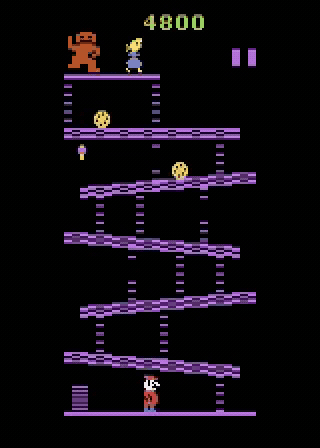
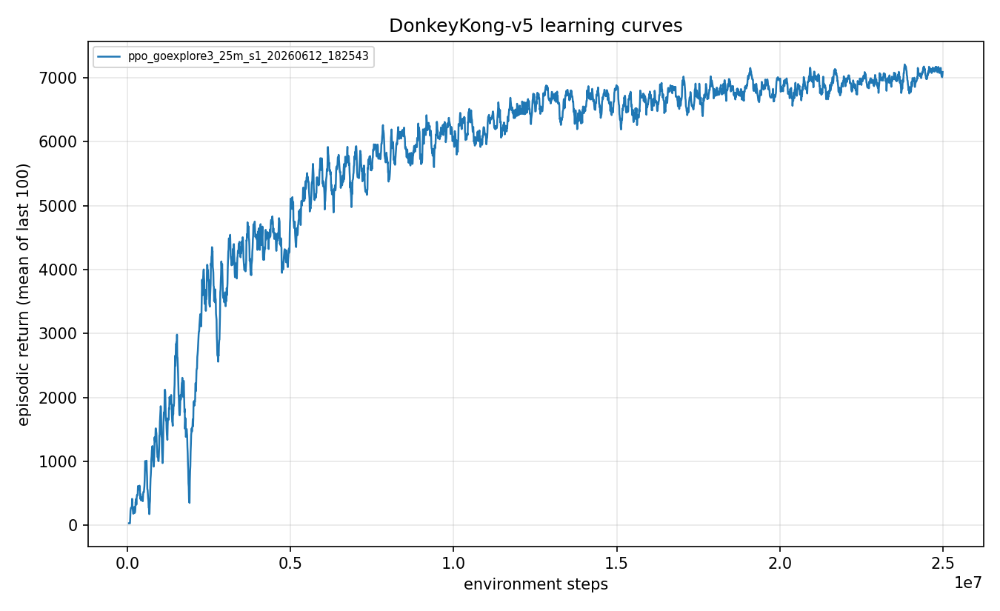

<!--
Experiment 06: Go-Explore finds a 30,100-point path.
Figures present in ./figures/: learning_curve.png, gameplay.gif. Embed only these.
No em dashes anywhere.
-->

# Experiment 06: Go-Explore finds a 30,100-point path

> One-line takeaway: a state-restore search discovered a verified 30,100-point Donkey Kong trajectory, far past anything a learned policy reaches, but that discovery is an open-loop replay, not a robust policy, and the gap between the two is the whole story.

By the end of [experiment 05](../05-final-agent-25m/writeup.md) the production agent was a boring plateau: the 25M recipe over three seeds pooled to a mean around 6,884, reliably cleared the first screen, and stopped climbing. Every method I had tried converged near 7,000. Before I could teach an agent to go deeper, I needed proof that "deeper" even existed in this ROM. This experiment is where I went looking, and found a path worth 30,100 points.

## The question

The wall was no longer "can the agent clear a screen." It was "is there anything past the wall to learn?" If the best route through Donkey Kong topped out around 8,000 points, then a 7,000 robust policy was almost optimal and there was nothing left to chase. If a much deeper route existed, then 7,000 was a learning failure, not a game limit.

So I separated two questions I had been conflating. Discovery: what is the deepest scoring route through this game, ignoring how hard it is to execute reliably? Policy: how well can a closed-loop network play under the stochastic evaluation protocol? My hypothesis was that these two numbers were far apart, and that the distance between them was the quantity worth measuring. To find the discovery number I needed a method that cares only about depth, not robustness.

## Method

[Go-Explore](../../docs/glossary.md) is a discovery method, not a learning method. Instead of training a network, it keeps an archive of interesting emulator states, restores a promising one, explores forward with bursts of held actions, and archives any new state that reaches a deeper cell. The key wrinkle is what "state" means: for the search it is the emulator's saved machine state (ale-py `cloneState`/`restoreState`), which round-trips exactly, not the four stacked 84x84 frames the policy sees. Because that save/restore is bit-exact and I ran the search deterministically (a fixed hash-based "sticky" perturbation rather than a random one), any action sequence it finds replays exactly. An explored 9,700 replays as exactly 9,700. That exact replay is what makes a discovery trustworthy: a fixed action sequence, an open-loop trajectory, with no policy in the loop.

The archive is keyed by game progress (boards cleared, current board, lives, coarse x/y bands, and a score band), selection is weighted toward depth, and expansion uses climb-friendly held-action bursts with mid-burst archiving so it does not skip past ladders. The most important trick was **iterative deepening**: each wave reseeds its archive from the previous wave's deepest trajectories, so the search resumes from the frontier instead of rediscovering the early game every time. This is what let it punch past the round-1 plateau.

Unlike experiment 05, this experiment is not training a policy to be good. It runs a search to find how deep the game goes, then separately distills the result into a policy to see how much depth survives reactive execution.

## Configuration

The distillation run (GE3) explores robust demonstrations through the exact training stack, then behavior-clones them with a permanent BC floor.

```yaml
# key knobs (full file: ./config.yaml)
name: ppo_goexplore3_25m
seed: 1
total_timesteps: 25_000_000
algo: ppo
env:
  num_envs: 64
  reward_transform: scale        # raw reward x 0.01 (not clipped)
  reward_scale: 0.01
bc:
  enabled: true
  demo_path: data/demos_det_v1.npz   # Go-Explore trajectories
  epochs: 10
  aux_coef: 1.0                  # behavior-cloning pressure
  aux_anneal_updates: 400        # annealed over 400 updates
  aux_coef_floor: 0.15           # permanent BC floor (load-bearing)
```

The search itself is CPU only, no GPU, about 10 workers per wave, and lives in `src/dkrl/explore.py`.

## Results

Two results, kept strictly separate, because they answer the two different questions above.

**Discovery (the headline).** Iterative-deepening Go-Explore found a trajectory scoring 30,100 from a fixed start, and a clean replay verified it exactly (explored 30,100, replayed 30,100). The frontier climbed across waves: 9,700 in wave 1, then 20,100, 24,900, 25,800, and finally 30,100. That crosses into round-three territory of the two-screen loop, three-plus screen clears with their completion bonuses on top of the rivet and barrel points.

| Metric | Value |
|---|---|
| Discovered trajectory score (open-loop) | 30,100 |
| Replay verification | explored 30,100, replayed 30,100 (exact) |
| Wave-by-wave frontier | 9,700 to 20,100 to 24,900 to 25,800 to 30,100 |
| Robustness | deterministic, NOT robust to sticky-action noise |
| Seeds | 1 (fixed start, seed 0) |

The gif below is that exact 30,100 open-loop run. No neural network is playing; it is the discovered action sequence replayed through the emulator. This is what "the game goes this deep" looks like.



**Policy (the sobering half).** I distilled the Go-Explore trajectories into a learned policy (GE3: behavior cloning with a permanent floor, on top of PPO) and evaluated it under the full stochastic protocol (100 episodes, sticky actions p=0.25, 18 actions, no-op starts, seed 1000).

| Metric | Value |
|---|---|
| Mean episode return | 7,123 +/- 743 |
| Median | 7,250 |
| Max | 8,000 |
| Min | 5,300 |
| Screen-1 clear rate | 1.00 |
| Seeds | 1 |
| Training steps | 25M |
| Run id | `ppo_goexplore3_25m_s1_20260612_182543` |

The learning curve climbs to a reliable screen-clearing policy and sits there. Robust play caps around 7,123, the same neighbourhood as every other pre-SIL method, even though the demonstrations it cloned reach 30,100.



So the two numbers are 30,100 (discovery) and 7,123 (robust policy). That roughly four-to-one gap is the central measured quantity of this experiment.

## Discussion

This experiment succeeded loudly at the easy question and failed instructively at the hard one.

The discovery worked because of iterative deepening. Wave 1 plateaued near 9,700 (round-two difficulty plus archive dilution at depth), and only by reseeding each wave from the previous frontier did the search march to 30,100. The exact-replay verification is why I trust it: a fixed action sequence that scores 30,100 every time, reproducibly, from `data/trajectory_30k.pkl`.

The policy did not work, and that is the useful part. A perfect 30,100 demonstration, cloned with a permanent BC floor, produced a robust policy capped at 7,123. The demonstrations were deep; the execution was shallow. The cause is the open-loop versus closed-loop distinction: the discovered trajectory is a fixed sequence replayed deterministically, while evaluation injects sticky actions (probability 0.25 of repeating the previous action). The moment the agent's chosen action repeats at the wrong frame, it lands in a state the fixed demonstration never visited, with no idea how to recover. Fireballs move 8 to 12 raw units per agent step, so a single mistimed input near them is fatal. Cloning a trajectory teaches the route, not how to survive perturbations of the route.

The discovery should not be oversold. A 30,100 trajectory is not "the agent reaches 30k" in any policy sense. It is a search artifact proving the game has 30k of reachable depth, which is why I now say open-loop every time. Both halves are single seed, so neither number is publication-grade alone, but the gap between them is robust to that caveat: every pre-SIL method I tried lands near 7,000 robust regardless of how deep its demonstrations went.

## Takeaway

A state-restore search found a verified 30,100-point path, far past anything a learned policy reaches, but discovering a deep route and executing it under noise are two different problems. The roughly four-to-one gap between the 30,100 open-loop discovery and the 7,123 robust policy is not a rounding error or a tuning miss. It is the cost of robust reactive execution under stochasticity.

## What's next

With a 30,100 demonstration in hand, the open question is whether a different policy class can hold more of that depth under noise. The next experiment distills the Go-Explore agent into a recurrent (LSTM) policy, on the theory that memory across the screen transition might survive sticky actions better than a feedforward frame stack: [Recurrent policies and the closed-loop ceiling](../07-recurrent-policy/writeup.md).

## Reproduce this

```bash
# Verify the discovered open-loop trajectory replays exactly.
uv run dkrl replay-demos --min-score 30000        # reports explored 30,100, replayed 30,100

# Render the 30,100 open-loop run.
uv run dkrl replay-video --trajectory data/trajectory_30k.pkl

# Distill the Go-Explore trajectories into a policy (GE3).
uv run dkrl train --config experiments/06-go-explore-discovery/config.yaml

# Evaluate the distilled policy under the protocol (100 episodes, sticky 0.25, seed 1000).
uv run dkrl evaluate --checkpoint checkpoints/ppo_goexplore3_25m_s1_20260612_182543/final.pt --episodes 100

# Learning-curve figure.
uv run dkrl plot results/metrics/ppo_goexplore3_25m_s1_20260612_182543.csv \
  --out experiments/06-go-explore-discovery/figures/learning_curve.png
```

## References

- Go-Explore, Ecoffet et al. 2021 (first return, then explore): https://arxiv.org/abs/2004.12919
- Machado et al. 2018, evaluation protocol for the Arcade Learning Environment: https://arxiv.org/abs/1709.06009
- The open-loop vs closed-loop distinction: [methodology note](../../docs/methodology.md)
- Previous experiment: [05 - The 25M final agent](../05-final-agent-25m/writeup.md)
- Next experiment: [07 - Recurrent policies](../07-recurrent-policy/writeup.md)