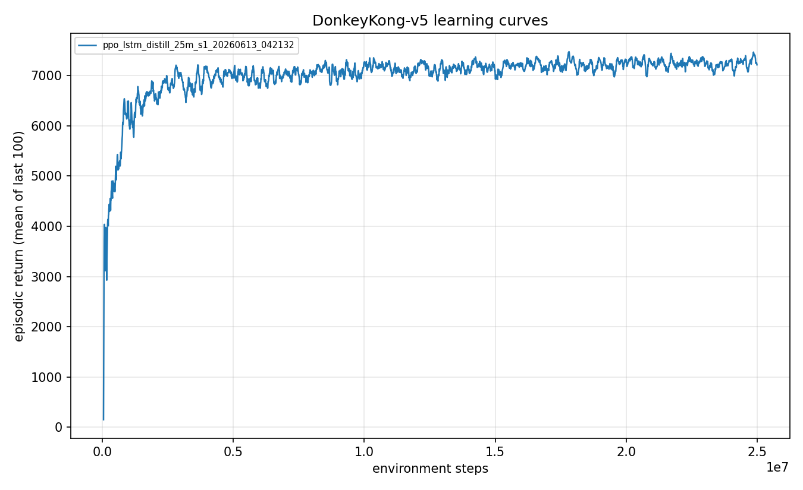
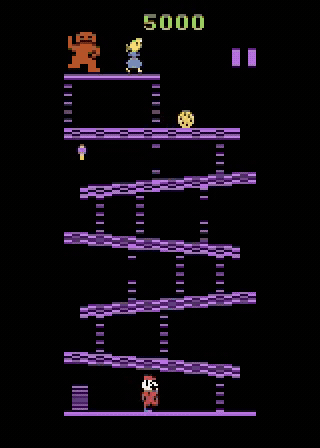

<!--
Experiment 07 write-up. Figures present: ./figures/learning_curve.png, ./figures/gameplay.gif.
Avoid em dashes.
-->

# Experiment 07: Recurrent policies and the closed-loop ceiling

> One-line takeaway: an LSTM policy distilled online from the Go-Explore agent reaches mean 7,285 with a perfect clear rate, the best robust closed-loop policy so far, and even giving the network memory does not push past the wall.

Experiment 6 gave me a Go-Explore search that could *find* a 30,100-point path through Donkey Kong, but the best policy that could actually *play* the game under live, stochastic control sat at mean 7,123 (the GE3 demonstration-kickstarted agent). The next suspect was architecture. Maybe a feedforward CNN that only sees four stacked frames cannot remember enough to play the rivets screen well. So I gave the policy memory. This is the story of building that LSTM correctly (it took three tries) and what it told me about the ceiling.

## The question

Every feedforward agent so far converged to roughly the same robust score, around 7,000 to 7,100, no matter how it got there. The hypothesis: the bottleneck is *observability*. The rivets screen streams fireballs at the agent, and a fireball's velocity is information you cannot read off a single instant. A 4-frame stack gives a crude finite-difference estimate of motion, but a recurrent policy carries a hidden state that can track flame velocity across arbitrarily long horizons. If memory was the missing piece, an LSTM should dodge better and exceed the 7,123 feedforward ceiling. If it landed at 7k anyway, that would be the strongest possible negative result: the wall survives even a change of architecture.

## Method

The one thing that differs from the standard setup: on top of the 4-frame stack, the policy carries a 256-unit LSTM hidden state propagated across timesteps, so it has memory beyond the 4-frame window.

I wanted an LSTM that *starts* at the GE3 agent's competence and fine-tunes from there, rather than learning from scratch. The first two attempts at that transfer failed; the third worked for a specific, learnable reason.

Attempt one was single-frame behavior cloning: train the LSTM to copy the expert's actions on demonstration frames, but with the hidden state zeroed for each frame. That state is never zero during a real rollout (it is carried forward), so the network learned a mapping that does not exist at inference time. The prior never transferred. The run sat at return 61 with a 0.00 clear rate through 9.8M steps. Killed.

Attempt two was offline distillation: match the expert's actions over real rollout *sequences* with the hidden state propagated correctly (0.887 action-match accuracy, LSTM clearing at 0.36 on its first evaluations). But once PPO took over with no term holding the imitated behavior in place, the policy washed itself out by update 30, back to return 96 and 0.00 clear. Same catastrophic-forgetting failure that sank the feedforward behavior-cloning experiments.

What finally worked is an **online distillation floor**. I copy the CNN trunk, distill GE3 into the LSTM over (T, N) rollout chunks with correct hidden-state propagation (0.887 accuracy), then keep the teacher *live* during PPO. An annealed teacher-matching cross-entropy is added to the loss, starting at coefficient 1.0 and decaying to a 0.4 floor over 800 updates. This is canonical kickstarting ([Schmitt et al.](https://arxiv.org/abs/1803.03835)) with a recurrent student. The floor holds the cleared behavior in place while PPO improves reactive execution on top of it. With that fix the policy starts at about 3,800 (clear 0.60) and *climbs* (4,522 at clear 0.67 by update 40) instead of collapsing.

## Configuration

Copy-pasteable, never a screenshot.

```yaml
# key knobs (full file: ./config.yaml)
name: ppo_lstm_distill_25m
seed: 1
total_timesteps: 25_000_000
algo: ppo_lstm
env:
  num_envs: 64
  reward_transform: scale      # raw reward x 0.01 (not clipped)
lstm:
  hidden_size: 256
  distill_teacher: <GE3 checkpoint>   # the 7,123 / 1.00-clear feedforward agent
  distill_chunks: 500                 # offline distill over rollout sequences first
bc:
  aux_coef: 1.0                       # online teacher-matching floor
  aux_anneal_updates: 800             # anneal 1.0 -> 0.4 over 800 updates
  aux_coef_floor: 0.4
```

## Results

Evaluation is 100 episodes under the full stochastic protocol (sticky actions p=0.25, 18 actions, no-op starts, no episodic-life trick, raw scores, seed 1000). Run id `ppo_lstm_distill_25m_s1_20260613_042132`.

| Metric | Value |
|---|---|
| Mean episode return | 7,285 +/- 737 |
| Median | 7,700 |
| Max | 8,100 |
| Min | 5,100 |
| Screen-1 clear rate | 1.00 |
| Seeds | 1 |
| Training steps | 25M |

The training return climbs to its plateau and *holds* there once the auxiliary pressure anneals away, rather than spiking and collapsing as the failed offline-distillation and feedforward behavior-cloning runs did:



And here is the agent playing under the live stochastic protocol: it clears the barrel screen reliably, then works the rivets screen until the streamed fireballs catch it.



The number to sit with: 7,285. That is a few percent *above* the 7,123 feedforward GE3 teacher it was distilled from, and the single best robust closed-loop agent so far. But it is within seed noise of GE3, and firmly inside the same 6,765 to 7,300 band that every other method class landed in. Memory nudged the needle. It did not move the wall.

## Discussion

This is a genuine engineering win: the third recurrent build is the best robust policy I have, and the lesson about *why* the first two failed is easy to get wrong and expensive to debug. A zeroed hidden state during behavior cloning is a different function than the carried state at rollout, and PPO with no holding term forgets a distilled prior just as fast as it forgets a cloned one. Online teacher distillation with an annealed floor is what made recurrence work at all.

The scientific result is a negative one, and the strongest so far. I gave the agent the one capability (memory across time) that a 4-frame stack provably lacks, on the exact screen (rivets, with its streamed fireballs) where motion tracking should matter most. The agent got marginally better and then hit the same ceiling. That rules out *observability* as the explanation for the wall. The bottleneck is not what the network can see or remember. It is how much reactive execution skill PPO can extract at this model scale and frame budget under 25 percent sticky-action noise, and that quantity is stubbornly fixed around 7,300 regardless of architecture.

For completeness: a follow-up pushed the recurrent agent toward the deep game by training from restored mid-game states. It collapsed (mean 206, clear 0.00). Trained only from restored states, it forgot how to play from a true game start, the same restore-distribution shift that hurt the feedforward rivets expert. A mixed-reset fix (50 percent real starts) did better but still degraded to mean 3,060 from the 7,285 starting point. Deep-state practice erodes the from-start clearing skill faster than start episodes can hold it. The standalone recurrent policy (7,285) remained the best agent.

Limits: this is a single seed. The headline (7,285) is within seed noise of the GE3 teacher (7,123), so I would not claim the LSTM is *better*, only that it is not *worse* and that memory clearly did not break the ceiling.

## Takeaway

An LSTM distilled online from the Go-Explore agent reaches mean 7,285 with a 1.00 clear rate, the best robust closed-loop policy so far. Online teacher distillation worked where single-frame behavior cloning and offline distillation both failed. The more important result is what it ruled out: across roughly eight to ten method classes, the closed-loop stochastic ceiling holds at about 7,300, and even an architecture change with explicit memory does not move it. The wall is not observability.

## What's next

If memory does not break the ceiling, maybe the policy can teach itself by relabeling its own visited states with a search expert. The next experiment chases that idea, search-based DAgger: [08 - search-based DAgger and the limits of a myopic expert](../08-search-dagger-negative/writeup.md).

## Reproduce this

```bash
# Train the recurrent policy (distills the GE3 checkpoint online, then PPO fine-tunes).
uv run dkrl train --config experiments/07-recurrent-policy/config.yaml

# Evaluate under the protocol (100 episodes, sticky 0.25, seed 1000).
uv run dkrl evaluate --checkpoint checkpoints/<run_id>/final.pt --episodes 100

# Figures.
uv run dkrl plot results/metrics/<run_id>.csv \
  --out experiments/07-recurrent-policy/figures/learning_curve.png
uv run dkrl video --checkpoint checkpoints/<run_id>/final.pt \
  --out gameplay.mp4 --episodes 3 --seed 1000
```

## References

- Kickstarting Deep Reinforcement Learning, Schmitt et al. 2018: https://arxiv.org/abs/1803.03835
- The discovery this builds on: [06 - Go-Explore finds a 30,100 path](../06-go-explore-discovery/writeup.md)
- The next dead end: [08 - search-based DAgger negative result](../08-search-dagger-negative/writeup.md)
