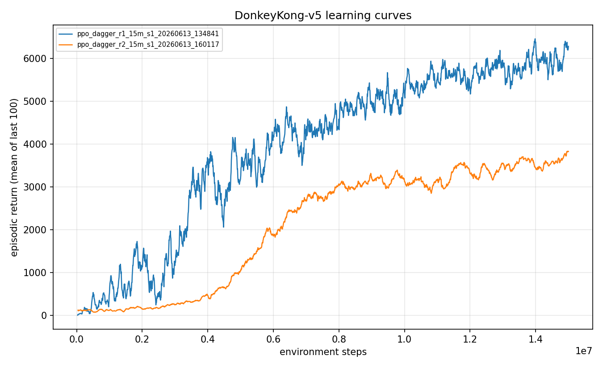

<!--
Experiment 08: Search-based DAgger (a negative result). Kept for the lesson.
Avoid em dashes (use periods, commas, or parentheses).
-->

# Experiment 08: Search-based DAgger, and why it failed

> One-line takeaway: DAgger only helps when the expert beats the policy, and a per-state search expert cheap enough to relabel thousands of states is too myopic to beat a 7k policy, so its labels actively dragged the agent down to 3,638.

By this point the agent had a repeatable problem. A Go-Explore search had *found* a 30,100-point path through the game ([experiment 06](../06-go-explore-discovery/writeup.md)), and a robust kickstarted policy reliably cleared the first screen, yet every closed-loop method converged near 7,285. The next idea was DAgger: instead of cloning a fixed demonstration set, let the agent play, then relabel the states it actually visits with what a search expert thinks it should have done. It did not work, and the way it failed is the point of this writeup.

## The question

The earlier behavior-cloning and kickstart attempts share a weakness called covariate shift: the demonstrations cover states the *demonstrator* visited, not the states the *agent* drifts into once it starts playing. DAgger is the standard fix. You run the current policy, collect the states it visits, ask an expert for the correct action at each, train on those corrected labels, and repeat. The states being labeled are exactly the ones the agent gets wrong in the wild.

The catch is where the expert comes from. With no human teacher in the loop, I built one from search: at each visited state, run a short random-shooting lookahead and return the first action of the best-scoring rollout. The hypothesis was that this per-state search could act as a cheap local expert. The risk, which [ADR 0005](../../docs/adr/0005-search-dagger-robust-deep-play.md) flagged up front, was that a per-state search might be too short-sighted to beat the already-strong policy. This experiment is where I found out which it was.

## Method

DAgger ([Ross et al. 2011](https://arxiv.org/abs/1011.0686)) is the interactive cousin of behavior cloning. Plain BC trains once on a fixed dataset and then suffers as the agent wanders off it. DAgger makes the agent's own visited states the training set, each relabeled by an expert. The one assumption that makes it work is easy to forget: the expert has to be *better than the policy* at those states. If the expert's label is worse than what the policy already does, you are not correcting drift, you are injecting noise.

One reward detail matters later: the DAgger labels use no shaped reward at training time, but the search expert internally scores its rollouts with game reward plus a height/board-progress potential.

What is new versus the kickstart work is the relabeler. The search expert runs, from each visited state, 24 depth-biased random-shooting rollouts over a 60-step horizon, scores each by accumulated game reward plus a height/progress potential, and returns the first action of the best one. The states come from running the strong base policy in the sticky environment across 10 parallel workers (ledger `kind=dagger_collect` rows). I aggregate those relabeled states with the existing robust demonstrations, BC-warm-start, then kickstart with PPO under an annealing auxiliary BC floor. I ran it twice.

**Round 1** collected about 1,100 relabeled states and folded them into the 97,328-pair robust demo set. **Round 2** removed round 1's confound (below): it collected about 3,000 search-relabeled states and built a 50/50 mix with subsampled robust demos (6,000 pairs total), so the search expert's labels actually drive learning instead of being a rounding error.

## Configuration

```yaml
# key knobs (full file: ./config.yaml), shown for the conclusive round 2
name: ppo_dagger_r2_15m
algo: ppo
seed: 1
total_timesteps: 15_000_000
env:
  num_envs: 64
  reward_transform: scale      # raw reward x 0.01
  reward_scale: 0.01
bc:
  enabled: true
  demo_path: data/demos_dagger_r2.npz   # 50/50 search-relabeled + robust demos, 6,000 pairs
  epochs: 10
  aux_coef: 1.0                # auxiliary BC term on the PPO loss
  aux_anneal_updates: 400
  aux_coef_floor: 0.2          # permanent BC floor so the labels do not wash out
```

The search expert itself (rollout count, horizon, progress potential) lives in the DAgger collection code, not the train config; the collection runs are the `dagger_collect` ledger rows.

## Results

Evaluation is 100 episodes under the full stochastic protocol (sticky actions p=0.25, 18 actions, no-op starts, no episodic-life trick, raw scores, seed 1000). Both rounds came out below the reference policies, and round 2 came out below everything.

| Metric | Round 1 (`ppo_dagger_r1_15m_s1_20260613_134841`) | Round 2 (`ppo_dagger_r2_15m_s1_20260613_160117`) |
|---|---|---|
| Mean episode return | 5,990 +/- 1,907 | 3,638 +/- 838 |
| Median | 6,400 | 4,100 |
| Max | 8,000 | 4,600 |
| Screen-1 clear rate | 0.92 | 0.00 |
| BC fit accuracy on its demo set | 0.893 | 0.282 |
| DAgger share of training data | ~1.1% (1,100 of 97,328) | ~50% (3,000 of 6,000) |
| Seeds | 1 | 1 |
| Training steps | 15M | 15M |

For reference, the base policy DAgger was meant to improve scored about 7,123, and the strongest closed-loop policy at this point sat at 7,285. The farming baseline (a no-demonstration agent that just jumps barrels at the bottom and never climbs) scores about 4,027. Round 2 landed *below* even that.

Both training runs climb. Neither climbs to a good place:



Round 1 (blue) rises to a training return near 6,000 to 6,400, a bit under the base policy. Round 2 (orange) climbs more slowly and plateaus near 3,800. This is not a learner that failed to optimize. It is a learner that optimized faithfully toward a bad target.

The single number that explains the experiment is the BC fit accuracy. On the robust demo set, the policy fits the labels at 0.893. On the DAgger-dominant set, it fits them at **0.282**. The labels are internally inconsistent: similar states get *different* actions across independent myopic search runs, because a 60-step random shoot is noisy and short-sighted. The network cannot cleanly fit a target that contradicts itself, so it neither imitates the search nor keeps its own competence, and round 2's clear rate falls to 0.00.

## Discussion

The two rounds were not equally conclusive.

Round 1 was a *suggestive* negative result, not a clean one. The 1,100 relabeled states were 1.1 percent of a 97,328-pair training set, so the search labels were almost completely drowned by the robust demos. The 5,990 result was plausibly within the seed-to-seed variance of the kickstart procedure. I could not claim the search expert had hurt anything, only that it had not helped.

Round 2 removed that confound by giving the search expert's labels 50 percent of the training signal. If the labels were good, a dominant dose should help a lot; if they were bad, it should hurt a lot. The result, mean 3,638 with clear rate 0.00 and BC accuracy 0.282, is unambiguous: a dominant search-expert signal *degrades* the policy, because the labels are mutually contradictory.

The underlying reason is the assumption I flagged at the start. The random-shooting expert produces sensible-looking individual labels (climb here, jump there), but a 60-step horizon cannot see a screen clear, so the height/progress potential is only a local proxy for "is this good." Sometimes that proxy prefers climbing when the policy's learned choice (dodge, reposition, wait for a gap) is genuinely better over the full episode. A myopic expert relabeling a non-myopic policy pulls it off its own stronger behavior.

The obvious fix is a *better* expert: replace random shooting with a proper per-state archive search (a mini Go-Explore from each visited state). The problem is fundamental rather than fixable. A per-state search strong enough to beat a 7k policy is roughly as expensive as the global Go-Explore that found the 30,100 path in the first place, and running that *per visited state at scale* was not tractable on this hardware (an initial attempt produced degenerate labels). Either the expert is cheap and myopic, or it is strong and as costly as the original control problem. There is no cheap strong expert hiding in the middle.

Both rounds are single seed, so neither score is a rigorous point estimate. But the conclusion does not rest on the exact value of 3,638. It rests on two facts that do not need multiple seeds: BC accuracy collapses to 0.282 (the labels contradict each other), and a 50 percent dose of those labels destroys the clear rate. The direction of the effect is the finding, not the decimal.

## Takeaway

DAgger needs an expert that beats the policy, and that is hard to build without a human. A per-state search cheap enough to relabel thousands of states is too myopic and noisy to beat an already-strong policy (its labels are mutually inconsistent, BC accuracy 0.282), and a per-state search strong enough to beat the policy costs about as much as the original problem. The expert-quality barrier is the same wall as the control problem itself. This is the lesson I keep the experiment for.

## What's next

If I cannot manufacture a better expert by search, the productive move is to stop importing correction from outside and instead amplify the good play the agent *already produces* on its own. That is self-imitation: replay the agent's own above-expectation episodes and learn to repeat them, with the deep demonstrations pinned permanently in the buffer so they cannot wash out. That is [experiment 09: breaking the ceiling with a permanent demo buffer](../09-sil-permanent-demo-buffer/writeup.md).

## Reproduce this

```bash
# 1. Collect on-policy states from the strong base policy and relabel each with the
#    random-shooting search expert (writes data/dagger_r2_w*.npz; one per worker).
uv run dkrl dagger-collect --checkpoint checkpoints/<base_run_id>/final.pt \
  --states-per-worker 300 --workers 10 --out data/dagger_r2

# 2. Build the 50/50 DAgger-dominant demo set (search-relabeled + subsampled robust demos).
uv run dkrl build-demos --dagger "data/dagger_r2_w*.npz" --robust data/demos_robust.npz \
  --mix 0.5 --total 6000 --out data/demos_dagger_r2.npz

# 3. Train (BC warm-start, then PPO with the annealing auxiliary BC floor).
uv run dkrl train --config experiments/08-search-dagger-negative/config.yaml

# 4. Evaluate under the protocol (100 episodes, sticky 0.25, seed 1000).
uv run dkrl evaluate --checkpoint checkpoints/<run_id>/final.pt --episodes 100

# 5. The two-round comparison figure.
uv run dkrl plot results/metrics/ppo_dagger_r1_15m_s1_20260613_134841.csv \
                  results/metrics/ppo_dagger_r2_15m_s1_20260613_160117.csv \
  --out experiments/08-search-dagger-negative/figures/comparison.png
```

## References

- DAgger (A Reduction of Imitation Learning), Ross et al. 2011: https://arxiv.org/abs/1011.0686
- Behavior cloning and covariate shift, defined in [the glossary](../../docs/glossary.md)
- Design rationale and the up-front myopia risk: [ADR 0005](../../docs/adr/0005-search-dagger-robust-deep-play.md)
- Previous experiment: [07 - a recurrent policy](../07-recurrent-policy/writeup.md)
- Next experiment: [09 - breaking the ceiling with a permanent demo buffer](../09-sil-permanent-demo-buffer/writeup.md)
- The discovery result the search expert was modeled on: [06 - Go-Explore finds a 30,100 path](../06-go-explore-discovery/writeup.md)