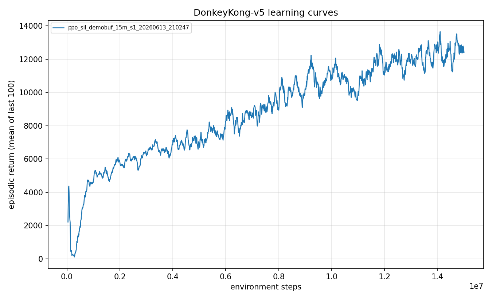
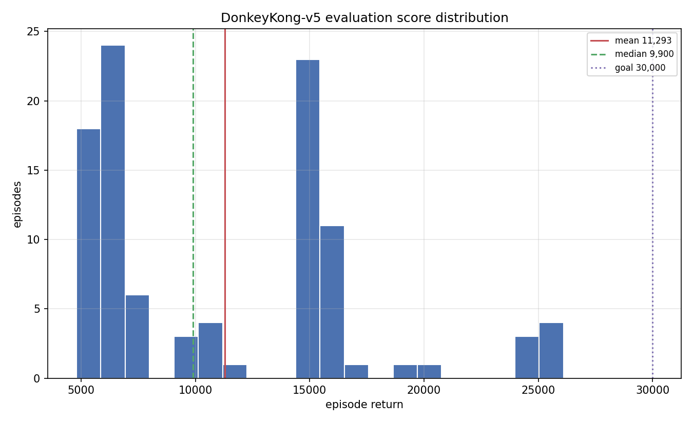
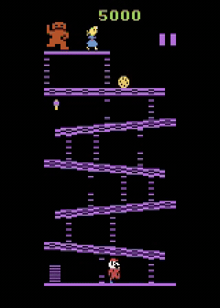

<!--
Experiment 09 write-up. Figures live in ./figures/ (learning_curve.png,
score_distribution.png, gameplay.gif). Avoid em dashes (periods, commas, parentheses).
-->

# Experiment 09: Breaking the ceiling with a permanent demo buffer

> One-line takeaway: parking three deep trajectories in a separate, non-evicting demo
> buffer and self-imitating from them on every update lifted the evaluation mean from
> 7,285 to 11,293, the first closed-loop policy in the campaign to durably beat the wall.

For eight experiments the agent kept hitting the same number. Reward shaping, intrinsic
motivation, behavior cloning, backward curricula, and most recently a search-driven DAgger
attempt (the [previous experiment](../08-search-dagger-negative/writeup.md)) all converged
back to roughly 7,285, even though Go-Explore had already *found* a 30,100-point path through
the game. The agent could be shown a great game and still not learn to play one. This is where
the ceiling first cracked.

## The question

By experiment 8 I suspected the wall was architectural: maybe a feedforward CNN with a 4-frame
stack simply cannot track fireballs and ladders well enough to play deep under sticky-action
noise, and 7,285 was the best this network could do. Every method that tried to inject the deep
Go-Explore play had failed the same way. Offline methods (behavior cloning, DAgger) learned the
deep trajectory but fell apart under covariate shift; online methods washed the deep behavior
out as soon as the auxiliary pressure annealed away.

Self-Imitation Learning ([SIL](../../docs/glossary.md)) is the method designed to pair with
Go-Explore: keep the agent's own good games in a replay buffer and periodically pull the policy
toward them. My hypothesis was that the blocker was not capacity but *forgetting*. If I could
keep the deep play permanently live inside the on-policy loop, sampled on every update, the
policy would stop converging back to 7k. This experiment tests whether a non-evicting
demonstration buffer is enough to make that happen.

## Method

No reward shaping is added here, so the SIL update is the only thing layered on top of PPO.

SIL keeps a replay buffer of the agent's own past transitions and periodically does an extra
update that pulls it toward the actions it took on episodes whose return beat the value estimate
(positive advantage). When you stumble into a good game, learn to do that on purpose.

The first time I ran SIL here it failed, and the failure is the whole point. Round 1 used a
single circular buffer of 150k transitions, seeded with the 30,100 trajectory. Within minutes
of self-play the flood of ordinary 7k transitions evicted the seeded deep ones, so SIL only ever
reinforced the policy's own 7k play. It reproduced the ceiling almost exactly (eval 7,265). That
negative result confirmed the buffer, not SIL, was the bug.

The fix is SIL-from-Demonstrations (arXiv 2203.10905): a SEPARATE, non-evicting demo region for
the deep trajectories that the self-play stream cannot touch. This round seeds it with three
deep runs (the 30,100 Go-Explore trajectory plus two deep-frontier waves scoring 25,800 and
23,500, about 11k transitions into a 15k-capacity region). Every SIL minibatch draws half its
samples (`demo_fraction: 0.5`) from that permanent region via return-prioritized sampling, so
the policy keeps imitating 30k-level play through all 15M steps while the other half is its own
positive-advantage self-play. Training is warm-started from the Go-Explore agent (the 7,123
checkpoint), not from scratch. The deep demos act as a fixed gravity well the on-policy learner
cannot wash out.

## Configuration

Copy-pasteable, never a screenshot.

```yaml
# key knobs (full file: ./config.yaml)
algo: ppo_sil
total_timesteps: 15_000_000
env:
  num_envs: 64
  reward_transform: scale      # raw reward x 0.01 (not clipped)
sil:
  init_from: checkpoints/ppo_goexplore3_25m_s1_.../final.pt  # warm-start from Go-Explore
  seed_trajectories:           # three deep runs: 30,100 + 25,800 + 23,500
    - data/trajectory_30k.pkl
    - data/explore_d3_w33.pkl
    - data/explore_d3_w32.pkl
  buffer_size: 120_000         # ordinary self-play (evicting)
  demo_buffer_size: 15_000     # permanent, non-evicting deep-demo region
  demo_fraction: 0.5           # half of every SIL batch is deep demos
  updates_per_iter: 4
```

## Results

Evaluation is 100 episodes under the full stochastic protocol (sticky actions p=0.25, 18
actions, no-op starts, no episodic-life trick, raw scores, seed 1000). Run
`ppo_sil_demobuf_15m_s1_20260613_210247`, config `configs/ppo_sil_demobuf.yaml`, git 6b57240.

| Metric | Value | Prior ceiling |
|---|---|---|
| Mean episode return | 11,293 | 7,285 |
| Median | 9,900 | - |
| Max | 26,100 | 8,100 |
| Std | 5,820 | - |
| Screen-1 clear rate | 1.00 | 1.00 |
| Seeds | 1 | - |
| Training steps | 15M | - |

Training return settled at 12,411 (best 13,652) with clears on essentially every episode. That
is the first run in the campaign that trained durably *above* 7,285 instead of climbing and then
sliding back to it. Round 1's single circular buffer, by contrast, landed at eval 7,265, the
ceiling reproduced to within a rounding error.



The distribution is the real story, and it is not a clean win. Roughly 48 percent of episodes
clear screen 1 and then die to sticky noise at the screen-1-to-2 transition (the 4,800 to 7,900
cluster), 43 percent reach screen 2 and beyond (8,000 to 18,000), and about 9 percent go very
deep (above 18,000, up to 26,100). The percentiles tell the same shape: p10 5,200, p25 6,300,
p50 9,900, p75 15,100, p90 16,500, p95 24,500. The mean is dragged down by that low cluster.
Every one of the 100 episodes clears screen 1 (single-step reward of 4,200 to 4,300 in all of
them), so the agent is now a genuine multi-screen player, not a screen-1 specialist that got
lucky.



And here it is playing. The trained policy clears the first screen, makes the transition, and
keeps looping the barrels-and-rivets pair rather than farming 100-point jumps at the bottom:



A protocol-compliant 8-episode render of the same checkpoint drew an even deeper tail than the
100-episode eval, including a single closed-loop episode of 31,200 (about seven screens, three
and a half barrels-to-rivets loops). That is the first *stochastic-play* episode in the 30k
range, distinct from the open-loop Go-Explore discovery trajectory that seeded the buffer. The
agent's reactive ceiling touches the goal at the episode level; the gap to a 30k *average* is
consistency.

## Discussion

The headline finding is not the number, it is what the number rules out. The 7,285 ceiling was
*not* an architectural wall of the feedforward CNN and 4-frame stack. It was a credit-assignment
and catastrophic-forgetting failure. Every prior method either learned the deep play offline and
suffered covariate shift (BC, the DAgger attempt in experiment 8) or learned it online and then
forgot it under distribution shift (kickstart, restore-reset). Keeping the deep demonstrations
live inside the on-policy PPO loop and sampling them on every update converts rare deep
experience into a robust reactive policy. Once the buffer stopped evicting the demos, SIL
delivered the pairing Go-Explore was designed for.

The round-1 failure deserves its own credit. A single circular buffer looked like a reasonable
default, and it quietly produced exactly the old ceiling. If I had not noticed that the seeded
transitions were gone within minutes, I might have written SIL off as another dead end. The bug
was an implementation detail (eviction policy), not the algorithm. A recurring lesson in this
project: the method is often right and the plumbing is wrong.

Honest limits. This is a single seed, so the headline is preliminary and needs three to five
seeds with an interquartile mean before it is anything more. And 11,293 is not the 30k goal. The
goal is a *mean* near 30k; the agent's max is already 26,100 and its p95 is 24,500, so deep play
is reliable once it survives the screen-1-to-2 transition. The 48 percent of episodes that die
at that transition are the entire remaining gap.

## Takeaway

Keep your best experience live inside the learner. Self-imitation from a separate, non-evicting,
return-weighted demonstration buffer, warm-started from the Go-Explore agent, turned a stuck
7,285 policy into one averaging 11,293 with a closed-loop episode reaching the 30k range. The
discovery-to-policy gap was a memory problem, not a capacity problem.

## What's next

The distribution points straight at the fix. The 48 percent low cluster dies at the screen
transition because three open-loop demos are not enough *variety* of deep play to anchor on, and
the Go-Explore trajectories are off the policy's own distribution. Would enriching the permanent
buffer with many more deep trajectories, and continuing training from this checkpoint rather than
starting over, close that cluster?

Next: [Reaching the 30k range with iterated self-imitation](../10-iterated-sil-30k/writeup.md).

## Reproduce this

```bash
# Train (warm-starts from the Go-Explore checkpoint named in the config).
uv run dkrl train --config experiments/09-sil-permanent-demo-buffer/config.yaml

# Evaluate under the protocol (100 episodes, sticky 0.25, seed 1000).
uv run dkrl evaluate --checkpoint checkpoints/<run_id>/final.pt --episodes 100

# Figures.
uv run dkrl plot results/metrics/<run_id>.csv \
  --out experiments/09-sil-permanent-demo-buffer/figures/learning_curve.png
uv run dkrl plot-dist --run <run_id> --goal 30000 \
  --out experiments/09-sil-permanent-demo-buffer/figures/score_distribution.png
uv run dkrl video --checkpoint checkpoints/<run_id>/final.pt \
  --out gameplay.gif --episodes 1 --seed 1000
```

## References

- Self-Imitation Learning, Oh et al. 2018: https://arxiv.org/abs/1806.05635
- Self-Imitation Learning from Demonstrations: https://arxiv.org/pdf/2203.10905
- Previous experiment: [08 - the search-driven DAgger negative result](../08-search-dagger-negative/writeup.md)
- Next experiment: [10 - reaching the 30k range with iterated self-imitation](../10-iterated-sil-30k/writeup.md)
- The discovery result this builds on: [06 - Go-Explore finds a 30,100 path](../06-go-explore-discovery/writeup.md)