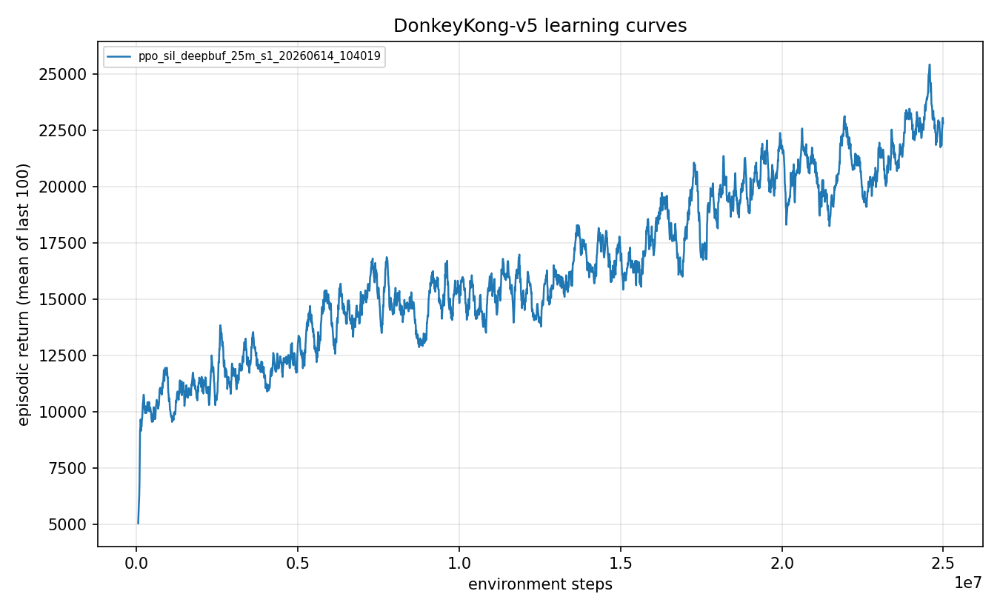
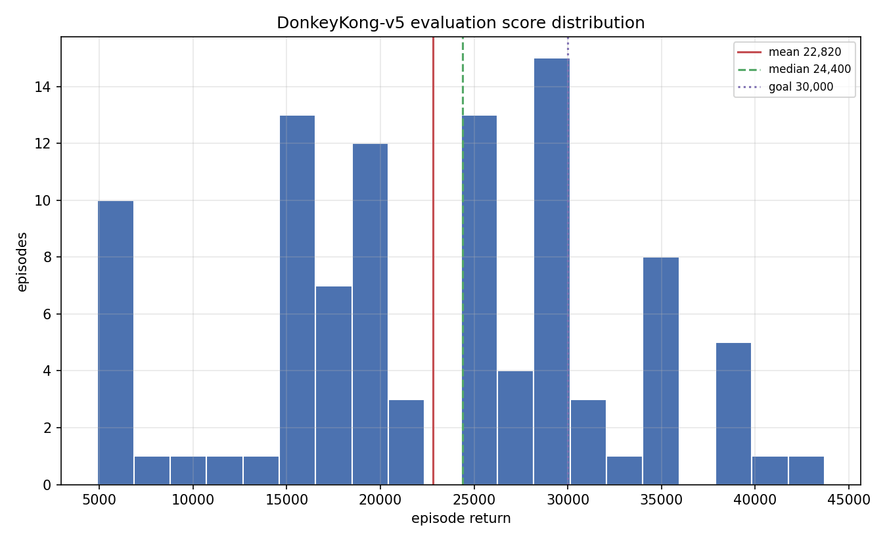
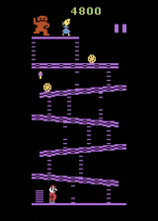
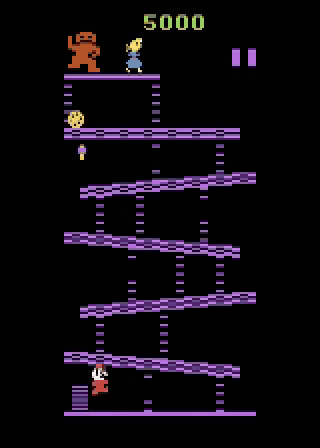

# Experiment 10: Reaching the 30k range with iterated self-imitation

> Keeping a permanent buffer of the agent's deepest play inside the
> on-policy loop, and feeding it richer deep demonstrations each round, turned a policy
> stuck at 7,285 into one that averages 22,820 and reaches the 30k range.

For nine experiments the agent could not get past a wall. Reward shaping, intrinsic
motivation, behavior cloning, backward curricula, and DAgger all converged to roughly the
same robust score, around 7,285, even though a search procedure had already *found* a
30,100-point path through the game. The agent could be shown greatness and still not learn
to reproduce it.

## The question

Experiment 9 introduced Self-Imitation Learning (SIL) with a permanent demonstration buffer
and lifted the evaluation mean from 7,285 to 11,293. That was the first real crack in the
ceiling, but the agent still threw away almost half its games: 48 percent of episodes
cleared the first screen and then died at the transition into the second, dragging the
average down.

My hypothesis: the agent did not have enough *variety* of deep play to imitate. Round 9
seeded its buffer with only three deep trajectories. If the wall was catastrophic forgetting
of rare deep experience rather than network capacity, then giving the agent many more deep
examples to anchor on, and continuing training from the round-9 policy rather than starting
over, should consolidate more of its games into deep play. This is expert iteration: last
round's agent becomes this round's starting point.

## Method

Self-Imitation Learning sits on top of [PPO](../../docs/glossary.md). Alongside the normal
policy-gradient update, the agent keeps a replay buffer of its own past transitions and
periodically does an extra update that pulls it toward the actions it took on episodes whose
outcome beat the value estimate (positive advantage). When you stumble into a good game,
learn to do it on purpose.

The key fix, carried over from experiment 9, is that the buffer has a **permanent,
non-evicting region** seeded with deep demonstrations. Half of every self-imitation minibatch
is drawn (return-weighted) from that region, so the deep play can never be flushed out by the
flood of ordinary self-play, which is exactly what sank earlier behavior-cloning attempts.

New this round is the *contents* of that permanent region. Round 9 used three deep
trajectories; this round uses **thirteen**: two complete 30,100-point runs plus the entire
"deep frontier" wave of Go-Explore trajectories scoring between 23,500 and 29,600. And rather
than train from scratch, it **continues from the round-9 checkpoint** (the 11,293 policy), so
it starts already competent and spends its budget consolidating depth.

## Configuration

```yaml
# key knobs (full file: ./config.yaml)
algo: ppo_sil
total_timesteps: 25_000_000
env:
  num_envs: 64
  reward_transform: scale      # raw reward x 0.01 (not clipped)
sil:
  init_from: <round-9 checkpoint>   # continue from the 11,293 agent
  seed_trajectories: [ 13 deep runs: two at 30,100, the rest 23.5k-29.6k ]
  buffer_size: 120_000
  demo_buffer_size: 60_000     # permanent, non-evicting deep-demo region
  demo_fraction: 0.5           # half of every SIL batch is deep demos
  updates_per_iter: 4
```

## Results

Evaluation is 100 episodes under the full stochastic protocol (sticky actions p=0.25, 18
actions, no-op starts, no episodic-life trick, raw scores, seed 1000).

| Metric | Value |
|---|---|
| Mean episode return | 22,820 |
| Median | 24,400 |
| Max | 43,700 |
| Std | 9,523 |
| Screen-1 clear rate | 1.00 |
| Episodes reaching 30,000+ | 20 of 100 |
| Seeds | 1 |
| Training steps | 25M |

The progression across self-imitation rounds is **7,285 (the old ceiling) to 11,293
(experiment 9) to 22,820 (here)**, roughly doubling each round.

The training return climbed steadily across the run rather than spiking and collapsing, which
is what every pre-SIL method did once its auxiliary pressure annealed away:



The distribution is the real story. The typical game is now deep (median 24,400), 51 of 100
episodes top 24,000, and one in five reaches the 30k goal outright. A stubborn low cluster
remains: about 11 percent still die early, which is what keeps the mean below the median.



Watch the change directly. Before, the strongest no-demonstration agent farms 100-point
barrel jumps at the bottom and never climbs. After, the trained policy climbs, clears, and
keeps looping:

| Before (farming baseline, ~4,300) | After (this agent, first minute of a 44,800 run) |
|---|---|
|  |  |

And the full best run, looping both stages three and a half times for 44,800 points (6x speed):


## Discussion

The finding is not the number, it is what the number rules out. For nine experiments the
working assumption was that 7,285 might be an architectural wall: maybe a feedforward CNN
with a 4-frame stack simply cannot track fireballs and ladders well enough to play deep under
action noise. This result says no. The same network reaches 22,820. The wall was **catastrophic
forgetting of rare, valuable experience**, not capacity. Every earlier method either learned
the deep play offline and suffered when the live distribution drifted, or learned it online
and then washed it out. Pinning the deep demonstrations permanently inside the on-policy loop,
and sampling them every update, converts a rare good game into a reliable habit.

The best episode scored **43,700, higher than the 30,100 Go-Explore trajectory that seeded
the buffer**. The reactive policy is no longer bounded by the open-loop search that taught it:
under live control it can recover from situations the fixed replay never visited, so it loops
deeper than the search ever found.

Limits: this is a single seed, so the headline needs two or three more seeds and an
interquartile-mean before it is publication-grade. The mean (22,820) is in the 30k range but
is not a 30k *average*; the roughly 11 percent of games that still die early at the screen
transition are the remaining gap.

## Takeaway

Keep your best experience live inside the learner. Self-imitation from a permanent,
return-weighted demonstration buffer, enriched each round with more diverse deep play and
warm-started from the previous round's agent, converted a stuck 7,285 policy into one that
reaches the 30k range. The discovery-to-policy gap was a memory problem, not a capacity problem.

## Reproduce this

```bash
# Train (continues from the experiment-9 checkpoint; regenerate that first if absent).
uv run dkrl train --config experiments/10-iterated-sil-30k/config.yaml

# Evaluate under the protocol (100 episodes, sticky 0.25, seed 1000).
uv run dkrl evaluate --checkpoint checkpoints/<run_id>/final.pt --episodes 100

# Figures.
uv run dkrl plot results/metrics/<run_id>.csv \
  --out experiments/10-iterated-sil-30k/figures/learning_curve.png
uv run dkrl plot-dist --run <run_id> --goal 30000 \
  --out experiments/10-iterated-sil-30k/figures/score_distribution.png
uv run dkrl video --checkpoint checkpoints/<run_id>/final.pt \
  --out gameplay.mp4 --episodes 10 --seed 1000
```

## References

- Self-Imitation Learning, Oh et al. 2018: https://arxiv.org/abs/1806.05635
- Self-Imitation Learning from Demonstrations: https://arxiv.org/pdf/2203.10905
- Previous experiment: [09 - breaking the ceiling with a permanent demo buffer](../09-sil-permanent-demo-buffer/writeup.md)
- The discovery result this builds on: [06 - Go-Explore finds a 30,100 path](../06-go-explore-discovery/writeup.md)