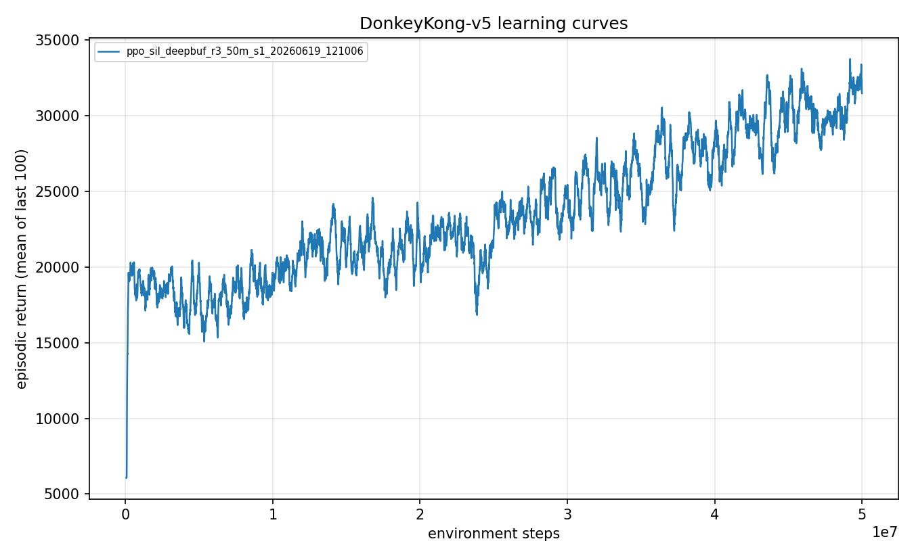
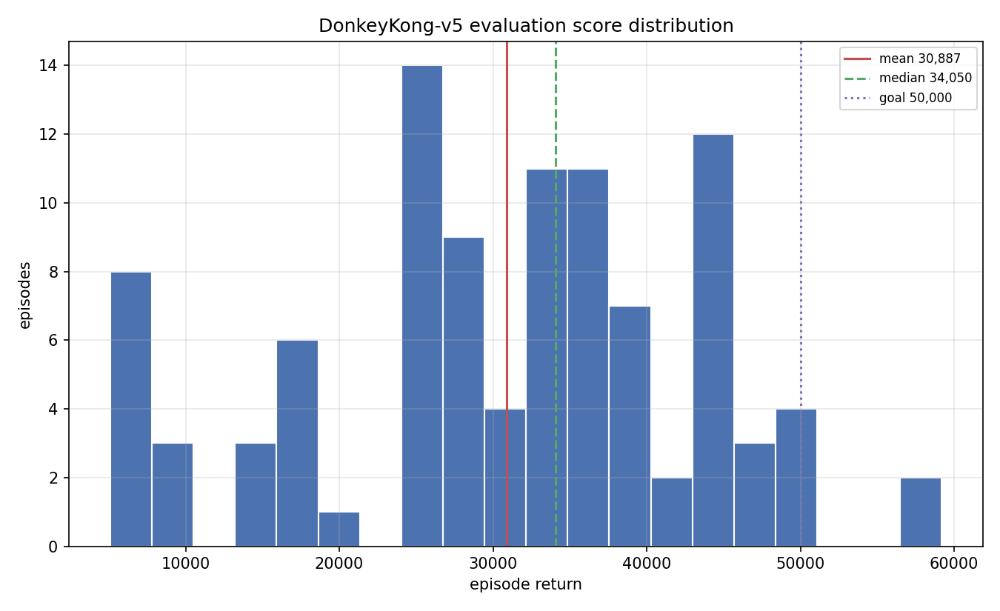
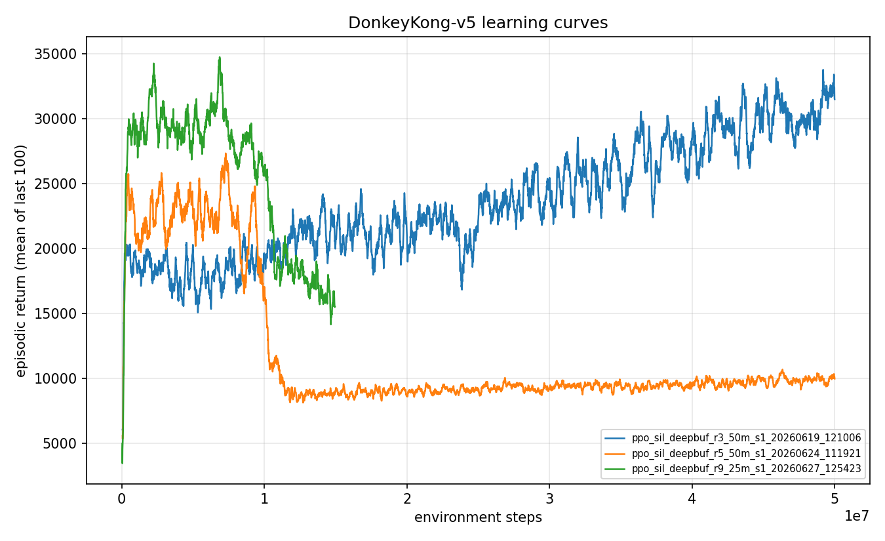

# Experiment 11: Past 30k, and the ceiling of iterated self-imitation

> One-line takeaway: one more round of iteration lifted the mean into the low-30,000s
> (3-seed IQM 34,033, pooled mean 32,420, with a 59,500 single-episode max, so 50k is
> reachable in one game), but six attempts to push the mean any further all collapsed.
> About 30k is a hard ceiling for this method.

[Experiment 10](../10-iterated-sil-30k/writeup.md) reached a mean of 22,820 by self-imitating
a permanent buffer of deep demonstrations, and its training curve was still rising when the
run ended. The obvious next move was simply more of it: continue training, harvest the agent's
own deeper games, feed them back. The first continuation worked and reached 30,887. Everything
after that hit a wall, and the wall turned out to be informative.

## The question

Self-imitation had roughly doubled the mean three rounds in a row (7,285 to 11,293 to 22,820).
Does it keep going toward a 50k mean, or is there a ceiling? And if it stalls, is the limit the
network's capacity, the game itself, or the training procedure?

## Method

Two new pieces of tooling supported the search. `harvest-demos` records the agent's own
episodes (observations, actions, and per-step rewards) so they can be seeded back into the
self-imitation buffer, with a `--min-return/--max-return` band filter to pick demonstrations at
a chosen depth. And I added a KL trust region (`target_kl` early-stopping) to the PPO loop,
which had never been wired in.

Round 3 was the straightforward continuation: resume from the experiment-10 checkpoint, same
13 Go-Explore demos, another 50M steps. Rounds 4 through 9 then tried, one variable at a time,
to push the mean past where round 3 landed:

- **4:** seed the agent's own 50,000 to 69,000 episodes into the permanent buffer.
- **5:** the control, round 3's exact recipe continued again.
- **6:** a gentle, non-annealed learning rate (5e-5) with band-filtered demos at ~45.5k.
- **7:** a stronger demo anchor (demo_fraction 0.6).
- **8:** demo_fraction 1.0, so the self-imitation update sees only the fixed demos and never
  the policy's own self-play.
- **9:** a KL trust region (target_kl 0.01) on top of the gentle learning rate.

## Configuration

```yaml
# round 3, the continuation that worked (full file: ./config.yaml)
algo: ppo_sil
total_timesteps: 50_000_000
sil:
  init_from: <experiment-10 checkpoint>   # mean 22,820
  seed_trajectories: [ 13 Go-Explore demos, 23.5k-30.1k ]
  demo_fraction: 0.5
# rounds 4-9 varied: seed_self_demos, demo_fraction (0.3-1.0),
# ppo.learning_rate (2.5e-4 -> 5e-5), ppo.target_kl (None -> 0.01)
```

## Results

Round 3 continued the stable climb and settled at a new best. The recipe is stable, so I ran
it at three seeds; the headline pools all 300 protocol episodes.

| Metric | Round 3 (3 seeds, 300 episodes) |
|---|---|
| Pooled mean | 32,420 (95% CI 30,788 to 34,025) |
| IQM | 34,033 (95% CI 31,759 to 35,942) |
| Median | 34,700 |
| Max | 59,500 |
| Screen-1 clear rate | 1.00 |
| Per-seed means | 30,887 / 32,531 / 33,843 |

The progression across self-imitation rounds is **7,285 to 11,293 to 22,820 to ~32,400**. The
training curve climbs steadily and holds, with no collapse:



The single best game scored **59,200**, so 50k is clearly reachable in one episode; the score
distribution shows the typical game is now genuinely deep (median 34,050) with a thick tail
toward 50k, against a stubborn low cluster that dies early:



Then the wall. Every attempt to push the mean past round 3 collapsed.

| Round | Change | Training peak | Outcome |
|---|---|---|---|
| 4 | seed own 50-69k episodes | 26k | collapse to ~10k |
| 5 | round-3 recipe, repeated | 21k | collapse, eval 10,053 |
| 6 | gentle LR, band demos | 31,418 | slow decay to ~9.5k |
| 7 | strong anchor (0.6) | - | collapse to ~9k |
| 8 | demo_fraction 1.0 | 31,013 | decay to ~17k |
| 9 | KL trust region | 34,485 | decay to ~15k |

The shape is always the same: a brief hold near 30k, sometimes a peak just above it, then a
slide down to a policy that still clears the first screen every time but dies early for ~10k.
The comparison below puts round 3 (which holds) next to rounds 5 and 9 (which recover from the
warm-start, then fall):



Round 9's peak (its update-800 checkpoint, at a 34,485 training return) is the closest anything
came to beating round 3, and it still evaluates to mean 28,607, below round 3. Nothing exceeded
30,887.

## Discussion

The negative result is sharper than the positive one. Round 8 is the key: with demo_fraction
1.0, the self-imitation update never touches the policy's own self-play, so the death-spiral I
first suspected (self-imitating one's own degrading games) is removed, and it *still* decayed.
That points the finger at PPO's own on-policy update: past about 30k, the gradient drifts the
policy downward faster than the fixed demos can anchor it. Round 9 tested that directly with a
KL trust region to forbid large policy shifts, and it held longest and peaked highest (34,485),
but the drift accumulates across many small in-budget steps and it collapsed anyway.

So the limit is not capacity (the same network scores 59,200 in a single game) and not the game
(50k is reachable). It is the training procedure: iterated self-imitation past ~30k is unstable,
and gentle learning rates, strong anchors, pure-demo imitation, and trust regions all delay the
collapse without preventing it. About 30k is where stable closed-loop play tops out for this
method.

Honest limit: the headline goal this campaign was set (a 50k *mean*) was not reached; 50k stands
only as a single-episode max. The 30k result itself is solid: three seeds pool to mean 32,420
(95% CI 30,788 to 34,025) with an IQM of 34,033, so it is a robust recipe, not a lucky run.

## Takeaway

Iterated self-imitation closed most of the discovery-to-policy gap, lifting the robust mean from
the old 7,285 ceiling to a 3-seed IQM of 34,033 (pooled mean 32,420), more than 4x, with a best
game of 59,500. But it has a ceiling of its own around 30k, set by training instability rather
than capacity or the game. A 50k mean is out of reach for this method on this setup; it would
need a fundamentally different paradigm.

## What's next

1. **A different paradigm for a higher mean.** The instability is in the policy-gradient
   continuation, so the candidates are model-based control (MuZero-style planning, which does not
   rely on this kind of continuation) or a dedicated training-stability effort. Both are large,
   multi-week undertakings rather than another overnight run.

## Reproduce this

```bash
# The round-3 continuation (the result).
uv run dkrl train --config experiments/11-past-30k-and-the-sil-ceiling/config.yaml
uv run dkrl evaluate --checkpoint checkpoints/<run_id>/final.pt --episodes 100

# Harvest the agent's own deep games as demos (used in the failed pushes).
uv run dkrl harvest-demos --checkpoint checkpoints/<run_id>/final.pt \
  --out data/self_demos.pkl --keep 20 --min-return 35000 --max-return 46000
```

## References

- Self-Imitation Learning, Oh et al. 2018: https://arxiv.org/abs/1806.05635
- Previous experiment: [10 - Reaching the 30k range](../10-iterated-sil-30k/writeup.md)
